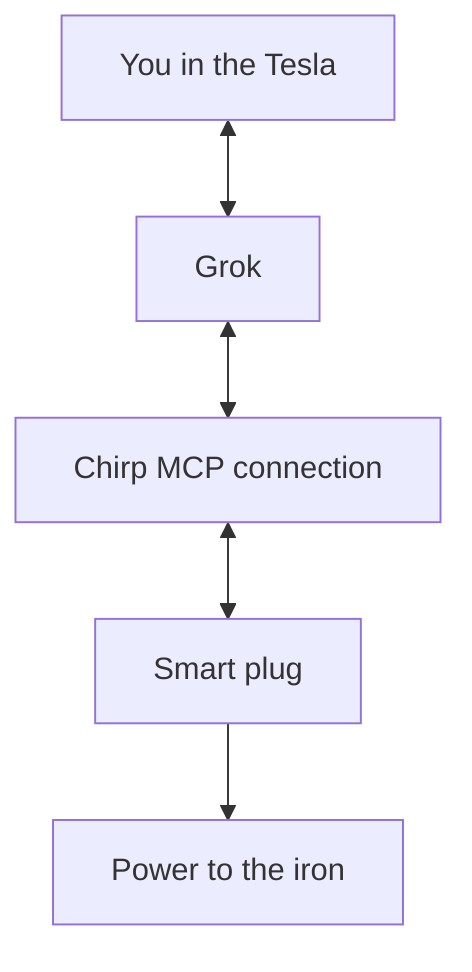

# Use Chirp from Your Tesla

You have left the house and cannot remember whether you turned off the iron. If it is plugged into a connected smart plug, you can ask Grok from your Tesla and switch it off by voice. Chirp's **MCP connection** lets Grok read your home's devices and run the actions you have set up for them.

<figure><figcaption>
Ask about your Chirp home through Grok in the car, using the same Grok account you connected on your phone or computer.
</figcaption></figure>

## “Hey Grok, is my iron on?”

Plug the iron into a **Milesight LoRaWAN smart plug**, such as the [WS523](https://www.milesight.com/iot/product/lorawan-sensor/ws523), and connect the plug to Chirp. The plug reports whether its power outlet is on and accepts a command to turn it off.

Here is an example conversation once that setup is ready:

> **You:** Hey Grok, is my iron on?
>
> **Grok:** Yes, your iron is on. Would you like me to turn it off?
>
> **You:** Yes, please turn it off.

Grok sends the plug's saved turn-off command through Chirp. Switching the plug off cuts power to the iron. You can then ask Grok to check the result. The dialogue illustrates the request; Grok's exact wording and confirmation prompts can vary.

## Get your home ready

1. Add the plug by following [LoRaWAN Devices](../devices/lorawan-devices.md). It needs gateway coverage, the correct device profile, and a working connection.
2. Give it an easy name, such as **Iron**, and map its reported on/off state in **Mapping**. Check that readings appear in Chirp.
3. Under **Commands & States**, create a **Turn off** command using the instructions for your exact plug model. [Creating Commands](../devices/commands/creating-commands.md) explains the settings; Milesight publishes the [WS52x command format](https://www.milesight.com/products/docs/en/ws52x/protocol/ws5xx/ws52x-downlink.html). Grok runs commands you save here.
4. Follow [Connect Grok](../api/mcp-server.md#connect-grok) on your phone or computer. Ask Grok to list your Chirp devices and check that it can find **Iron** in the correct home.

You can use this Grok connection on your phone or computer too. The car gives you another place to have the conversation.

## Bring the connection into your Tesla

The car needs an **AMD processor**, software **2026.26 or later**, and **Premium Connectivity or Wi-Fi**. [Tesla's Grok guide](https://www.tesla.com/support/grok) covers availability and account requirements.

1. Open **App Launcher → Grok** on the touchscreen and tap **Sign In**. Complete sign-in on your phone with the Grok account you connected to Chirp.
2. Hold the steering-wheel microphone button to start talking, or enable **“Hey Grok”** in **Controls → Audio → Grok Settings**.
3. Ask: *“Use Chirp to check whether my iron is on.”* Your account's connectors are available in the car. See [Tesla's setup instructions](https://www.tesla.com/support/grok).

## Other things to ask on your way out

- *“What is the temperature in the living room?”* Grok uses the mapped reading from your room sensor.
- *“Are the hallway lights on? Please switch them off.”* The connected lights need a reported state and a saved command.
- *“Are there any active leak or smoke alerts at home?”* Grok checks the [alerts](../alarm/README.md) recorded by the sensors and automations you have configured.

If you manage more than one home, ask Grok which home it is using. The normal connection follows your selected home in Chirp; you can also [fix it to one home](../api/mcp-server.md#choosing-which-home-it-sees).

## When something does not respond

If Grok cannot see Chirp in the car, check the car's software, connectivity, and Grok account. If it sees your home but cannot find the plug or its state, check the device name, mapping, and last update in Chirp.

If the action is missing, check the saved command and your permission to run it. If it is accepted or queued, ask Grok for the execution status and the plug's latest reported state. [Command Verification](../devices/commands/verification.md) explains how Chirp checks device feedback.
