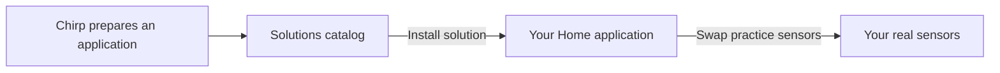

# What are applications and solutions in Chirp?

Picture a leak-protection setup for your home that is already built: practice sensors reporting under a kitchen sink, a dashboard that shows them, an automation that notices water, and an alert that is addressed to you. You did not draw a single widget or configure anything. You pressed one button, and the setup shows you which use case Chirp can solve for you.

That is the idea behind **Solutions** in Chirp. A **solution** is a ready-made application from the Chirp catalog: pre-configured for one home use case, with a list of the real devices to buy. When your devices arrive, you can ask the AI chat to connect them to the application. When you install it, Chirp creates your own **application**, a working bundle of devices, dashboards, automations, and alerts for one household job. Read [What is a ready-made home solution?](solutions-explained.md) for the whole picture.

## Why start from a ready-made setup?

* **You see the result first.** The practice sensors in a solution report from the first second, so the dashboard is never empty.
* **Nothing to assemble.** Sensors, dashboard, automation, and alert already work together.
* **You keep the real thing in mind.** An application's checklist can tell you where to mount each sensor and how to connect it.
* **Your own pace.** Replace the practice sensors with real ones one at a time. The views and automations stay as they are.

## Where should you go next?

| You want to | Read |
|---|---|
| Understand the terms | [What is a ready-made home solution?](solutions-explained.md) |
| See what is on offer | [How do I explore ready-made solutions?](exploring-ready-made-solutions.md) |
| Set one up | [How do I install a ready-made solution?](installing-a-ready-made-solution.md) |
| Connect your real sensors | [How do I move from practice sensors to real ones?](from-practice-sensors-to-real-ones.md) |

## What if you would rather build it yourself?

An application you build by hand is exactly the same kind of thing as one you install, so you can always start from nothing.

1. [Create an application](creating-an-application.md), such as Home Watch, and describe what you use it for.
2. Set up the devices, dashboard, rules, and alarm definitions you need.
3. [Assign the resources](organizing-content.md) through their **Application** fields. Configure the rule to use the intended device and alarm definition; putting them in the same application does not create that behavior automatically.
4. Choose **Applications → My applications**, open the application, and use **Dashboard** to view its dashboards or **Content** to find its resources.

Your application belongs to the selected organization. Family members need the relevant permissions to see or change its devices, dashboards, rules, and alarms; the application does not grant extra access. If you later retire a setup, [check what deletion removes](deleting-an-application.md) first.
