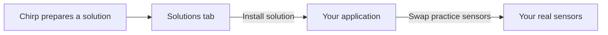

# What are applications and solutions in Chirp?

Say you rent out a property on Airbnb. Your guests keep leaving the lights on, and you are far away. Or you worry about parties, but you do not want to spy on the people staying there. Or you simply want to know the moment a pipe starts leaking. If you have no idea how to automate any of that, or where to begin, solutions are made for you.

Open **Solutions** and you see what we have prepared: a party monitor that listens to noise levels without watching anyone, a leak watch for your properties, a way to switch the lights off from wherever you are, and more as we add them. New ones arrive with every release.

Each of these usually means a lot of work. Sensors to pick, a dashboard to draw, automations to write, alerts to set up. When you do not know what is possible at home, that can feel like too much.

So we did the work. Press **Preview**, then **Use this solution**, then **Install solution** on the next screen, and the solution appears in your account with practice sensors that send believable readings. You see what the dashboard looks like, how the automations run, and how the alerts reach you. It is all set up, and you can still change any of it. Because you start from something that works, you learn quickly how everything fits together and where to find it.

Practice sensors are sample sensors that send realistic readings, so the dashboard has something to show before your real sensors arrive. You will also see them called emulated devices and the Emulator in the screens.

Then you think, "This is exactly my problem." The solution lists the devices you need to buy. Order them, and when they arrive, swap the practice sensors for the real ones. You can swap them yourself or ask the AI chat to connect them for you. Problem solved.

## What is the difference between a solution and an application?

A **solution** is the ready-made template we prepared. An **application** is what you have in your account after you install one, with its sensors, dashboard, automations, and alerts together. You can also build an application of your own from scratch. After the install it is a normal application you can change freely. [Read more about the two terms.](solutions-explained.md)

## How do I get started?

1. Choose **Applications** in the left sidebar and keep the **Solutions** tab selected.
2. [Look through the solutions](exploring-ready-made-solutions.md) and press **Preview** on one that matches your situation.
3. [Press **Use this solution**, then **Install solution**](installing-a-ready-made-solution.md) on the next screen, and read what it created and which devices it needs.
4. Buy those devices and [swap the practice sensors for the real ones](from-practice-sensors-to-real-ones.md).

## What do automation, alert, and connector mean?

* **Automation:** a rule that reacts to a reading, for example turns something off or sends an alert.
* **Alert** (you will also see **alarm**): a notification that tells you something needs attention.
* **Connector:** the link that brings a sensor's readings into Chirp. LoRaWAN and MQTT are two common ways sensors connect, and the sensor's manual tells you which one it uses.
* **Organization:** your Chirp account space. For a single household, it is simply your home.

## Why start from a ready-made setup?

* **You see the result first.** The practice sensors in a solution report from the first second, so the dashboard is never empty.
* **Nothing to build first.** Sensors, dashboard, automation, and alert already work together.
* **You keep the real thing in mind.** An application's checklist can tell you where to mount each sensor and how to connect it.
* **Your own pace.** Replace the practice sensors with real ones one at a time. The views and automations stay as they are.

## Where should you go next?

| You want to | Read |
|---|---|
| Understand the terms | [What is a ready-made home solution?](solutions-explained.md) |
| See what is on offer | [How do I explore ready-made solutions?](exploring-ready-made-solutions.md) |
| Set one up | [How do I install a ready-made solution?](installing-a-ready-made-solution.md) |
| Connect your real sensors | [How do I move from practice sensors to real ones?](from-practice-sensors-to-real-ones.md) |

## Can I build my own application?

Yes. An application you build by hand is the same kind of thing as one you install, so you can always start from nothing. This route takes more work than installing a solution. If you are new, install a solution first and look at how it is set up.

1. [Create an application](creating-an-application.md), such as Home Watch, and describe what you use it for.
2. Set up what you need: [devices](../devices/adding-sensors.md), a [dashboard](../dashboards/building-a-dashboard.md), [automations](../rules-engine/your-first-automation/README.md), and [alerts](../alarm/set-up-a-home-alert.md).
3. [Add each one to your application](organizing-content.md) with its **Application** field. Then make sure the automation points to the right device and alert. Putting them in the same application does not connect them.
4. Choose **Applications → My applications**, open the application, and use **Dashboard** to see its dashboards or **Content** to see everything in it.

Your application belongs to the selected organization. Family members need the right permissions to see or change its devices, dashboards, automations, and alerts. The application does not give anyone extra access. If you later retire a setup, [check what deletion removes](deleting-an-application.md) first.
