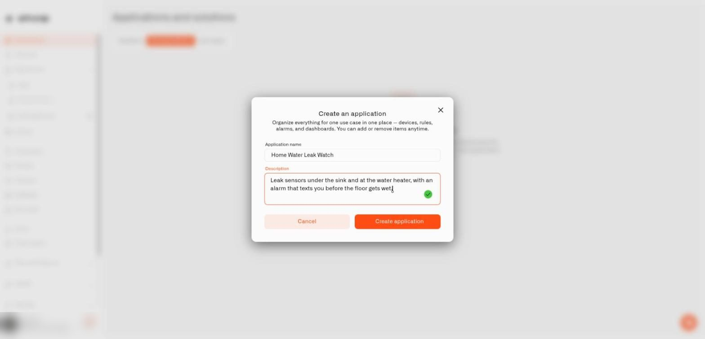
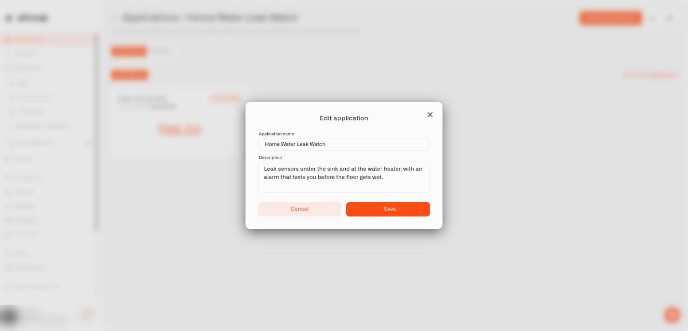

# Creating an Application

Use this guide when you are assembling your own household solution in Chirp. First create the application, then set up and assign the devices, dashboards, rules, and alarms it needs. If you prefer a head start, [install a ready-made solution](installing-a-ready-made-solution.md), which gives you an application like this one. A name such as **Home Watch** identifies the purpose of the setup.

Before starting, check the organization shown in the sidebar. You need to belong to that organization. There is no separate Applications permission; the permissions for devices, dashboards, rules, and alarms still determine what you can see or change inside the setup.

<figure><figcaption>
The Create an application dialog, filled in.
</figcaption></figure>

## What is on the My applications screen?

Choose **Applications** in the left sidebar, then the **My applications** tab. The heading **Applications** has a line beneath it explaining that the list holds both the setups you installed and the ones you built yourself.

* **Create an application** is the orange button at the top right.
* **Search** narrows the list as you type. It matches words in the application's name and in its description.
* The table has the columns **Name**, **Description**, **Dashboards**, **Devices**, **Rules**, and **Alarms**. The last four are counts of what the application holds. A dash instead of a number means Chirp could not read that count, which is not the same as zero.
* Each row ends with an arrow icon. Select it to open the application.

An organization with no applications shows **Create your first application** and the same button. If the list cannot load you see **Could not load applications**, and a search with no hits reads **No applications found**.

## Make Home Watch

1. Choose **Applications** from the sidebar.
2. In **My applications**, select **Create an application**. A dialog opens, titled **Create an application**, with the line "Organize everything for one use case in one place" under it.
3. Fill in **Application name** with `Home Watch`.
4. Optionally enter a **Description**, such as `Home conditions and alerts while we are away.`
5. Select **Create application** and open the application.

If you leave **Application name** empty, the field turns red and reads **Application name is required**. A toast confirms **Application created successfully**; if something goes wrong you see **Failed to create application**.

The description is a note for the people using the setup. It does not instruct Chirp to create sensors or automations. Open **Content** to begin checking which resources you have assigned.

## Change the name later

Open the application. At the top right, beside the trash can, is a pencil icon. It opens the **Edit application** dialog with **Application name** and **Description**; change either one and choose **Save** (or **Cancel** to leave things as they were). A toast reads **Application updated successfully**. Give each application a recognizable name so that you can tell them apart when assigning a sensor or dashboard.

<figure><figcaption>
The Edit application dialog.
</figcaption></figure>

## Can I create an application while adding a device or dashboard?

Yes. Every form that has an **Application** field, such as **Add device**, **Add dashboard**, a rule, or an alarm, offers **Default**, each of your applications, and **Add new application** at the end of the list. Choose **Add new application** and a text box labeled **Application name** appears with a **Create** button. Type a name and press **Create** (or Enter). Chirp makes the application and selects it for you, so there is nothing to pick again. Under the field, a hint says your applications list can be found on the **Applications page**, and that is a link to it. Finish and save the device or dashboard as usual. If you leave the form without saving, the new application still exists.

Continue with [Organizing Content](organizing-content.md) to bring your household setup together.
