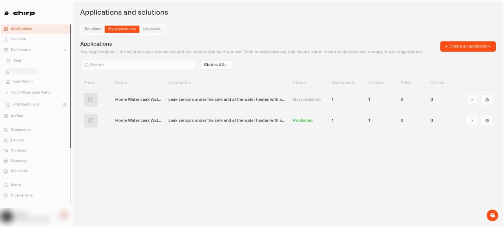

# Creating an Application

Use this guide when you are assembling your own household solution in Chirp. First create the application, then set up and assign the devices, dashboards, rules, and alarms it needs. If you prefer a head start, [install a ready-made solution](installing-a-ready-made-solution.md), which gives you an application like this one. A name such as **Home Watch** identifies the purpose of the setup.

Before starting, check the organization shown in the sidebar. You need to belong to that organization. There is no separate Applications permission; the permissions for devices, dashboards, rules, and alarms still determine what you can see or change inside the setup.

<figure><figcaption>
The Create an application dialog, filled in.
</figcaption></figure>

## What is on the My applications screen?

Choose **Applications**, then the **My applications** tab. Under the heading **Applications** a line explains that the list holds solutions you installed and ones you built yourself.

* **Create an application** is the button at the top right.
* **Search** narrows the list by name.
* **Status: All** is a filter. Accounts that publish setups can narrow by **Published** or **Not published**; for a household it can stay on All.
* The table has columns **Photo**, **Name**, **Description**, **Status**, **Dashboards**, **Devices**, **Rules**, and **Alarms**. **Status** reads **Not published** for a setup of your own. The last four columns count what the application holds. At the end of each row, the arrow opens the application and the gear icon opens its settings.

An empty organization shows **Create your first application** with the same button.

<figure><figcaption>
The My applications tab.
</figcaption></figure>

## Make Home Watch

1. Choose **Applications** from the sidebar.
2. In **My applications**, select **Create an application**. A dialog opens, titled **Create an application**, with the line "Organize everything for one use case in one place" under it.
3. Fill in **Application name** with `Home Watch`.
4. Optionally enter a **Description**, such as `Home conditions and alerts while we are away.`
5. Select **Create application** and open the application.

The description is a note for the people using the setup. It does not instruct Chirp to create sensors or automations. Open **Content** to begin checking which resources you have assigned.

## Change the name later

Open the application and select the pencil icon at the top right. An **Edit application** dialog opens with **Application name** and **Description**; change either one and choose **Save** (or **Cancel** to leave things as they were). Give each application a recognizable name so that you can tell them apart when assigning a sensor or dashboard.

<figure><figcaption>
The Edit application dialog.
</figcaption></figure>

An **Application** field elsewhere in Chirp can also offer **Add new application**. This lets you create the grouping while working on a resource. Select the new application and finish saving that resource.

Continue with [Organizing Content](organizing-content.md) to bring your household setup together.
