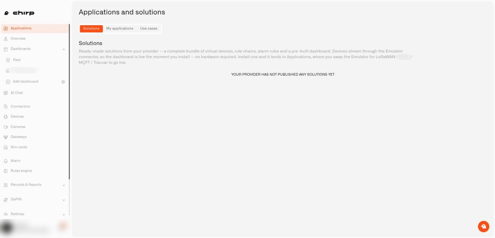
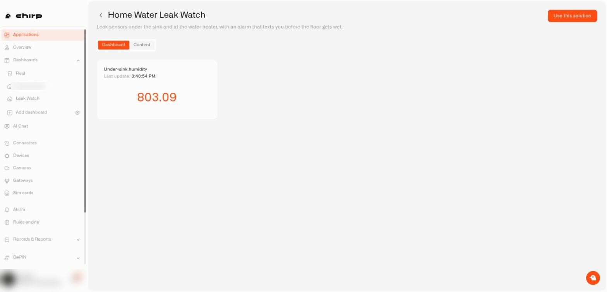
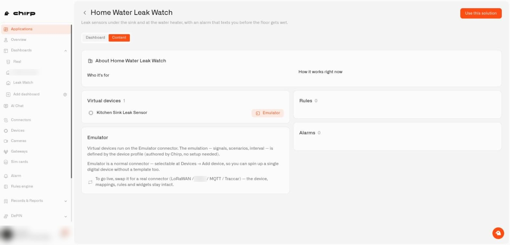

# How do I explore ready-made solutions?

You can look inside any solution before you install it. Walk through its dashboard, see what comes with it, and read the plain-words description. Nothing gets created while you browse.

## How do I open the Solutions tab?

1. Choose **Applications** in the left sidebar. The page is titled **Applications and solutions**.
2. Pick the **Solutions** tab. It comes first, right before **My applications**.

Under the **Solutions** heading, a short paragraph lists what each solution brings: practice sensors, automations, alerts, and a dashboard that is ready to go. The practice sensors send sample readings, so the dashboard shows live numbers the moment you install. You need no hardware. They arrive through the Emulator connector, which is simply the link that carries their readings into Chirp. (Some screens call practice sensors emulated devices or the Emulator.)

<figure><figcaption>
The Solutions tab with one ready-made solution.
</figcaption></figure>

## What is on a solution card?

Each card shows:

* **Photo.** A picture of the setup. A few cards have none.
* **Name and description.** The name tells you the job or the place at home. The description sums it up in a line.
* **Four counters.** Virtual devices (your practice sensors), rules (automations), widgets (tiles on the dashboard), and alarms (alerts). A glance tells you if a solution is a small helper or covers the whole house.
* **Preview.** The button at the bottom. It opens the solution and installs nothing.

Chirp looks after the catalog, so what you see depends on what has been added so far.

If nothing has been added yet, the tab reads **Your provider has not published any solutions yet**. That wording is the app's own. It just means the catalog is empty for now, so check back later. When the list cannot be fetched, you see **Couldn't load the solution catalog**. Give it a moment and reload.

<figure><figcaption>
The Solutions tab before any solution is added to the catalog.
</figcaption></figure>

## How do I preview a solution?

Press **Preview** on a card. The page that opens has a header and two tabs.

In the header, a back arrow takes you to the catalog. Next to it you see the solution's name with its description below. On the right sits **Use this solution**, which leads on to the install page. Previewing never creates anything.

### What does the Dashboard tab show?

**Dashboard** comes first. It shows the finished dashboard with readings from the practice sensors, and they are really running. Gauges move, charts fill in. Look around the way you would on any dashboard of your own.

<figure><figcaption>
The Dashboard tab of a preview.
</figcaption></figure>

### What does the Content tab show?

**Content** explains the setup in words and lists what is inside. It covers:

* **About.** The solution's name and its explanation, with two columns next to it: **Who it's for** and **How it works right now**. Many solutions put an installation checklist in the second column, saying where each real sensor goes.
* **Virtual devices.** One row per practice sensor, each marked with an **Emulator** badge.
* **Rules.** Each automation, with a sentence saying what it does.
* **Alarms.** Each alert, tagged with a severity such as Low or Critical. An alarm is the notification that says something needs your attention.
* **Emulator.** A card explaining that you can swap the practice sensors for real ones later, while your devices, mappings, rules, and widgets stay put.

<figure><figcaption>
The Content tab of a preview.
</figcaption></figure>

If the About text has a checklist, read it before you buy anything. It shows how each real sensor fits into the setup.

## What if the preview shows a message?

* **Preview is unavailable right now.** The preview did not load. Try again shortly.
* **This solution has no dashboards to preview.** There is no dashboard to show, but **Content** still works.
* **Solution not found.** Chirp may have taken it out of the catalog after you opened the page. Go back and choose another.

Found one you like? Press **Use this solution**, then continue with [How do I install a ready-made solution?](installing-a-ready-made-solution.md)
