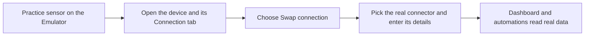

# How do I swap practice sensors for real ones?

The practice sensors in a solution exist so you can watch the whole setup work first. When your real sensors arrive, you point the same setup at them. This page shows the installed application and the exact screens involved.

## What does my new application look like?

After the install, **Go to application** opens the application page. The title reads **Applications /** followed by the application's name, with a pencil icon (edit) and a trash can (delete) at the top right. If the setup has a description, it sits in small grey text under the title. Two tabs sit underneath:

* **Dashboard** has one button per dashboard that came with the setup, named after the dashboard, and a **Go to the dashboard** link at the right. Each widget carries an **Emulator** badge while it reads from a practice sensor. If the setup has no dashboard you see **This application has no dashboards yet**, and a dashboard with nothing on it says **This dashboard has no widgets yet**.
* **Content** lists **Devices**, **Dashboards**, **Rules**, and **Alarms**, each in its own card. While any device in the application is still a practice sensor, an **Emulator** card sits at the bottom of the left column. It explains the swap and offers **Go to connectors**. Once the last practice sensor has been swapped, the card goes away.

## How do I swap a practice sensor for the real one?

1. Make sure the [connector](../connectors/README.md) for your sensor exists. If not, choose **Go to connectors** on the Emulator card and add it first.
2. Open the application's **Content** tab, then select a device under **Devices**. The device editor opens with the tabs **Device info**, **Connection**, **Emulator**, **Mapping**, and **Logs**. If the device has **Support commands** switched on, a **Commands & States** tab appears too.
3. Open **Connection**. At the top, under the heading **Choose a connector to add a device**, you will see **Connector type** showing **Emulator**, and a **Swap connection** link on the right.
4. Select **Swap connection**. The link turns into **Cancel swap** and **Connector type** becomes a drop-down. Choose the real connector, such as LoRaWAN, MQTT, or a tracker, then fill in the fields it shows.
5. Keep the **Device data key** rows as they are: each row is one reading, shown with its **Data type**, an **Emulator** button, and a trash can. They carry your mappings across, so the dashboard keeps working.
6. Select **Save**. The **Reception** strip at the bottom reports **Receiving & storing** with a **LIVE** marker once real readings arrive.

Read the solution's **Content** text before you begin. Providers usually write down the identifiers each device needs.

## How do I tell a practice sensor from a real one?

Look at the small badge beside a device name on the application's **Content** tab, in your Devices list, and on dashboard widgets. **Emulator** is a practice sensor. A real sensor shows **live** while it is sending readings and **offline** when it has gone quiet, followed by its technology, for example **live · LoRaWAN**, **offline · MQTT**, or **live · Tracker**. **not connected** means the device has no real connection set up yet.

<figure><figcaption>
The Connection tab of a practice sensor, with Swap connection at the top.
</figcaption></figure>

## What do the other device tabs do while it is still a practice sensor?

* **Emulator** lets you type a value for any reading and choose **Save**, or **Send once** to push a single reading through right away. Use it to test an automation without waiting.
* **Mapping** lists each reading's **Device data key**, current **Value**, **Last update**, **Normalized key**, **Unit**, **Type**, and **Data type**, with a trash can at the end of the row to remove a reading from the list. Hover over the **Device data key** header for a reminder that the key is part of the device configuration. For a practice sensor these rows follow the device configuration, so add or rename readings on the **Connection** tab instead.
* **Commands & States** appears only when **Support commands** is on. It is where you define the actions an operator can send to the device and see their results; see [Commands](../devices/commands/README.md).

<figure><figcaption>
The Emulator tab.
</figcaption></figure>

<figure><figcaption>
The Mapping tab.
</figcaption></figure>

## What stays the same, and what changes?

Readings keep their names and units, and the dashboard, automations, and alerts carry on. Only the source of the numbers changes, and the **Emulator** badge disappears from that device.

## Can I swap one sensor at a time?

Yes. Replace them in any order; the rest keep simulating until you get to them. For background reading, see [Pretend Sensors](../devices/pretend-sensors.md) and the [Emulator Connector](../connectors/emulator-connector.md).
