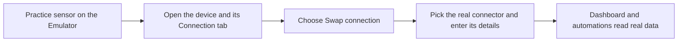

# How do I swap practice sensors for real ones?

An installed solution starts with practice sensors, so your dashboard shows lively readings from the first minute. (Some screens call them emulated devices or the Emulator.) Once your own sensors arrive, you point the setup at them. Nothing gets rebuilt. Only the source of the numbers changes, and your dashboards, automations, and alerts carry on.

## What do I need before swapping?

* **Your real sensor**, switched on and close enough to its gateway or network.
* **How it connects.** The sensor's manual tells you: LoRaWAN, MQTT, or a tracker. A connector is the link that brings its readings into Chirp.
* **Its identifiers.** These are printed on the label or listed in the manual.

No connector of that type in your account yet? Press **Go to connectors** on the application's **Emulator** card, or read [Connectors](../connectors/README.md), then come back.

## How do I get to the device?

1. Open **Applications → My applications** and select your application. The title reads **Applications /** followed by its name. A pencil icon (edit) and a trash can (delete) sit at the top right.
2. Open the **Content** tab. The **Emulator** card at the bottom of the left column is there as long as any device is still a practice sensor. It explains the swap and offers **Go to connectors**.
3. Under **Devices**, select the device you want to swap. The device editor opens.

The **Dashboard** tab next to it has one button per dashboard, and every widget wears an **Emulator** badge while it reads from a practice sensor. If the setup has no dashboard, you see **This application has no dashboards yet**. A dashboard with nothing on it says **This dashboard has no widgets yet**.

## What are the tabs of the device editor?

The editor has the tabs **Device info**, **Connection**, **Emulator**, **Mapping**, and **Logs**. If **Support commands** is switched on for the device, a **Commands & States** tab shows up as well. For the swap you use **Connection** and, sometimes, **Mapping**. The rest are handy to know.

### What is on the Connection tab?

This is where the swap happens. Under the heading **Choose a connector to add a device** you see **Connector type** set to **Emulator**, with a **Swap connection** link on the right. Below it come the **Device data key** rows and, at the bottom, the **Reception** strip.

A device data key is the name a sensor uses for one reading, such as temperature. Each row shows its **Data type**, an **Emulator** button, and a trash can.

<figure><figcaption>
The Connection tab of a practice sensor, with Swap connection at the top.
</figcaption></figure>

### How do I start the swap?

1. Select **Swap connection**. The link turns into **Cancel swap**, and **Connector type** becomes a drop-down.
2. Choose the connector your sensor uses: LoRaWAN, MQTT, or a tracker.
3. Fill in the fields that appear, using the identifiers from your sensor's manual or label.
4. Leave the **Device data key** rows as they are. That is what lets the dashboard go on working.
5. Select **Save**.

Change your mind halfway? **Cancel swap** leaves the device on the Emulator. Also worth a look: the solution's **Content** text often lists the identifiers each device needs.

### How do I know the swap worked?

After saving, watch the **Reception** strip on the **Connection** tab. Real readings are arriving when it says **Receiving & storing** with a **LIVE** marker.

If it does not, go through these in order:

1. Compare the identifiers you typed with the sensor's label. One wrong character is enough to break it.
2. Make sure the sensor is on and in range of its gateway or network.
3. Check the connector. With MQTT, see [How do I troubleshoot MQTT and Zigbee2MQTT?](../connectors/mqtt/troubleshooting.md). For other connectors, see [Connection diagnostics](../devices/connection-diagnostics.md).

Still no luck? Contact Chirp support.


A real sensor may report its readings under different names than the practice sensor did. If the dashboard stays empty after the swap, open the **Mapping** tab and match the real sensor's names to the readings the dashboard uses.


### What do the Emulator and Mapping tabs do?

**Emulator.** While the device is a practice sensor, type a value for any reading and choose **Save**, or choose **Send once** to push one reading through right away. It is a quick way to try an automation without waiting.

<figure><figcaption>
The Emulator tab.
</figcaption></figure>

**Mapping.** This tab shows each reading's **Device data key**, current **Value**, **Last update**, **Normalized key** (Chirp's standard name for the reading), **Unit**, **Type**, and **Data type**. A trash can at the end of a row removes that reading from the list. For a practice sensor the rows follow the device setup, so add or rename readings on the **Connection** tab instead.

<figure><figcaption>
The Mapping tab.
</figcaption></figure>

**Commands & States.** It only appears with **Support commands** on. Define the actions you can send to the device and see how they turned out. See [Commands](../devices/commands/README.md).

## What stays the same, and what changes?

| Stays the same | Changes |
|---|---|
| Reading names and units | Where the readings come from |
| Dashboards and widgets | The device's connector type |
| Automations and alerts | The identifiers you enter for the real sensor |

The **Emulator** badge also disappears from each device once you swap it.

## Can I swap one sensor at a time?

Yes, in any order. Swapped ones send real readings, and the others keep sending practice readings until their turn. Once the last practice sensor is gone, the **Emulator** card leaves the **Content** tab.

## How do I tell a practice sensor from a real one?

Look for the small badge beside a device name. You find it on the **Content** tab, in your Devices list, and on dashboard widgets.

* **Emulator** marks a practice sensor.
* **live** means a real sensor is sending, and **offline** means it has gone quiet. The badge adds the technology, for example **live · LoRaWAN**, **offline · MQTT**, or **live · Tracker**.
* **not connected** means no real connection is set up yet.

For more background, see the page on pretend (practice) sensors, [How do I create a pretend sensor in Chirp?](../devices/pretend-sensors.md) and the [Emulator Connector](../connectors/emulator-connector.md).
