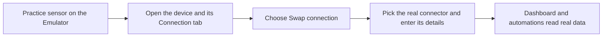

# From Practice Sensors to Real Ones

The practice sensors in a solution exist so you can watch the whole setup work first. When your real sensors arrive, you point the same setup at them. This page shows the installed application and the exact screens involved.

## What does my new application look like?

After the install, **Go to application** opens the application page. Its header shows **Applications / ** followed by the name, with a pencil (edit) and a trash can (delete) at the top right. A **Publish application** button also appears for accounts that are allowed to share setups; as a household member you can ignore it. Two tabs sit underneath:

* **Dashboard** shows the dashboards that came with the setup, with a **Go to the dashboard** link at the right. Each widget carries an **Emulator** badge while it reads from a practice sensor.
* **Content** lists **Devices**, **Dashboards**, **Rules**, and **Alarms**. At the bottom is an **Emulator** card that explains the swap and offers **Go to connectors**.

## How do I swap a practice sensor for the real one?

1. Make sure the [connector](../connectors/README.md) for your sensor exists. If not, choose **Go to connectors** on the Emulator card and add it first.
2. Open the application's **Content** tab, then select a device under **Devices**. The device editor opens with the tabs **Device info**, **Connection**, **Emulator**, **Mapping**, **Attributes**, **Calculated data**, and **Logs**.
3. Open **Connection**. At the top, under the heading **Choose a connector to add a device**, you will see **Connector type** showing **Emulator**, and a **Swap connection** link on the right.
4. Select **Swap connection**. The link turns into **Cancel swap** and **Connector type** becomes a drop-down. Choose the real connector, such as LoRaWAN, MQTT, or a tracker, then fill in the fields it shows.
5. Keep the **Device data key** rows as they are: each row is one reading, shown with its **Data type**, an **Emulator** button, and a trash can. They carry your mappings across, so the dashboard keeps working.
6. Select **Save**. The **Reception** strip at the bottom reports **Receiving & storing** with a **LIVE** marker once real readings arrive.

Read the solution's **Content** text before you begin. Providers usually write down the identifiers each device needs.

## What do the other device tabs do while it is still a practice sensor?

* **Emulator** lets you type a value for any reading and choose **Save**, or **Send once** to push a single reading through right away. Use it to test an automation without waiting.
* **Mapping** lists each reading's **Device data key**, current **Value**, **Last update**, **Normalized key**, **Unit**, **Type**, and **Data type**. For a practice sensor these rows follow the device configuration, so add or rename readings on the **Connection** tab instead.

## What stays the same, and what changes?

Readings keep their names and units, and the dashboard, automations, and alerts carry on. Only the source of the numbers changes, and the **Emulator** badge disappears from that device.

## Can I swap one sensor at a time?

Yes. Replace them in any order; the rest keep simulating until you get to them. For background reading, see [Pretend Sensors](../devices/pretend-sensors.md) and the [Emulator Connector](../connectors/emulator-connector.md).
