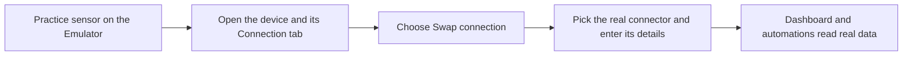
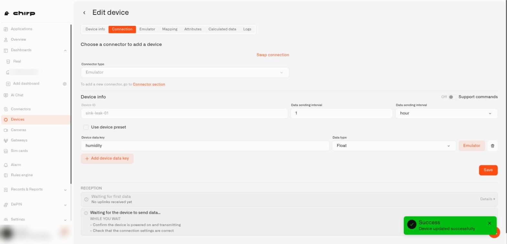
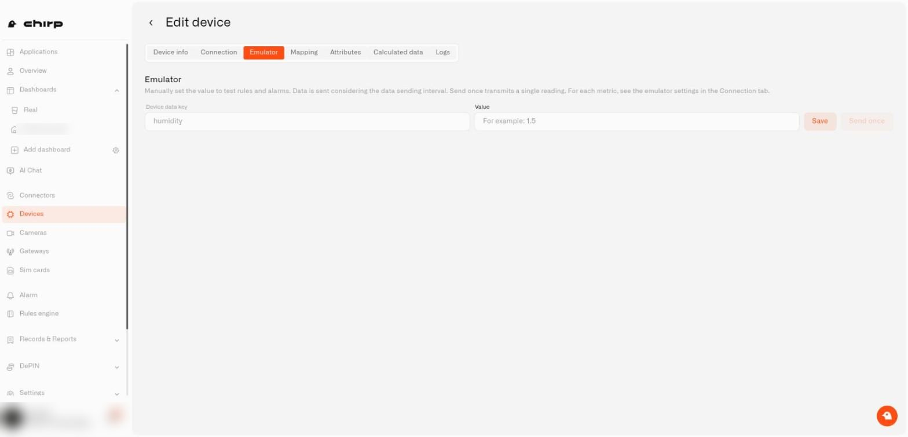
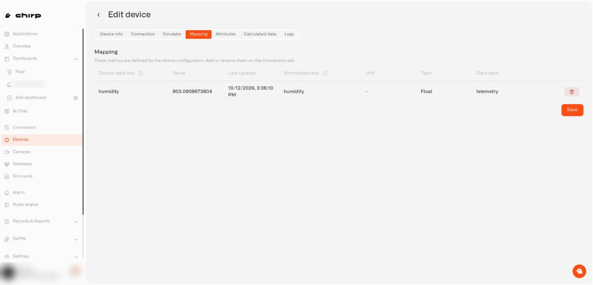

# How do I swap practice sensors for real ones?

This page helps you point your installed setup at your real sensors. The dashboard, automations, and alerts stay put. Only the source of the numbers changes.

## What do I need before swapping?

You need your real sensor and to know how it connects. The sensor's manual says which way it uses: LoRaWAN, MQTT, or a tracker. A connector is the link that brings a sensor's readings into Chirp.

If your account has no connector of that type yet, add one first. Press **Go to connectors** on the application's **Emulator** card, or read [Connectors](../connectors/README.md). Then come back here.

## What does my new application look like?

After the install, **Go to application** opens the application page. The title reads **Applications /** followed by the application's name. At the top right you see a pencil icon (edit) and a trash can (delete). If the setup has a description, it sits in small grey text under the title.

Two tabs sit underneath.

### What is on the Dashboard tab?

**Dashboard** has one button per dashboard that came with the setup, named after the dashboard. A **Go to the dashboard** link sits at the right. Each widget carries an **Emulator** badge while it reads from a practice sensor.

Two short messages can show up here. If the setup has no dashboard, you see **This application has no dashboards yet**. A dashboard with nothing on it says **This dashboard has no widgets yet**.

### What is on the Content tab?

**Content** lists **Devices**, **Dashboards**, **Rules**, and **Alarms**, each in its own card. While any device in the application is still a practice sensor, an **Emulator** card sits at the bottom of the left column. It explains the swap and offers **Go to connectors**. Once you swap the last practice sensor, the card goes away.

## How do I swap a practice sensor for the real one?

Read the solution's **Content** text before you begin. It usually lists the identifiers each device needs.

1. Make sure the [connector](../connectors/README.md) for your sensor exists. If not, press **Go to connectors** on the Emulator card and add it first.
2. Open the application's **Content** tab, then select a device under **Devices**. The device editor opens.
3. Open **Connection**. At the top, under the heading **Choose a connector to add a device**, you see **Connector type** showing **Emulator**, and a **Swap connection** link on the right.
4. Select **Swap connection**. The link turns into **Cancel swap**, and **Connector type** becomes a drop-down. Choose the real connector, such as LoRaWAN, MQTT, or a tracker.
5. Fill in the fields it shows. These are the identifiers from your sensor's manual or label.
6. Keep the **Device data key** rows as they are. A device data key is the name the sensor uses for one reading, such as temperature. Each row shows its **Data type**, an **Emulator** button, and a trash can. Keeping the rows lets the dashboard keep working.
7. Select **Save**. The **Reception** strip at the bottom reports **Receiving & storing** with a **LIVE** marker once real readings arrive.

The device editor has the tabs **Device info**, **Connection**, **Emulator**, **Mapping**, and **Logs**. If the device has **Support commands** switched on, a **Commands & States** tab appears too. For the swap you need **Connection** and, if the names differ, **Mapping**. The others are optional.

<figure><figcaption>
The Connection tab of a practice sensor, with Swap connection at the top.
</figcaption></figure>


A real sensor may report its readings under different names than the practice sensor. If the dashboard stays empty after the swap, open the **Mapping** tab and match the real sensor's names to the readings the dashboard uses.


## What if the Reception strip does not show LIVE?

1. Check the identifiers you entered on the **Connection** tab. One wrong character is enough.
2. Check that the sensor is powered on and in range of its gateway or network.
3. If you use MQTT, see [How do I troubleshoot MQTT and Zigbee2MQTT?](../connectors/mqtt/troubleshooting.md). For other connectors, see [Connection diagnostics](../devices/connection-diagnostics.md). Still stuck? Contact Chirp support.

## Can I swap one sensor at a time?

Yes. Replace them in any order. The rest keep sending practice readings until you get to them.

## What stays the same, and what changes?

Readings keep their names and units, and the dashboard, automations, and alerts carry on. The **Emulator** badge disappears from the device you swapped.

## How do I tell a practice sensor from a real one?

Look at the small badge beside a device name. You find it on the application's **Content** tab, in your Devices list, and on dashboard widgets.

* **Emulator** is a practice sensor.
* **live** means a real sensor is sending readings, and **offline** means it has gone quiet. The badge adds its technology, for example **live · LoRaWAN**, **offline · MQTT**, or **live · Tracker**.
* **not connected** means the device has no real connection set up yet.

## What do the other device tabs do while it is still a practice sensor?

* **Emulator** lets you type a value for any reading and choose **Save**, or **Send once** to push a single reading through right away. Use it to test an automation without waiting.
* **Mapping** lists each reading's **Device data key**, current **Value**, **Last update**, **Normalized key** (Chirp's standard name for the reading), **Unit**, **Type**, and **Data type**. A trash can at the end of a row removes that reading from the list. For a practice sensor these rows follow the device configuration, so add or rename readings on the **Connection** tab instead.
* **Commands & States** appears only when **Support commands** is on. Define the actions you can send to the device there, and see their results. See [Commands](../devices/commands/README.md).

<figure><figcaption>
The Emulator tab.
</figcaption></figure>

<figure><figcaption>
The Mapping tab.
</figcaption></figure>

For background, see [How do I create a pretend sensor in Chirp?](../devices/pretend-sensors.md) and the [Emulator Connector](../connectors/emulator-connector.md).
