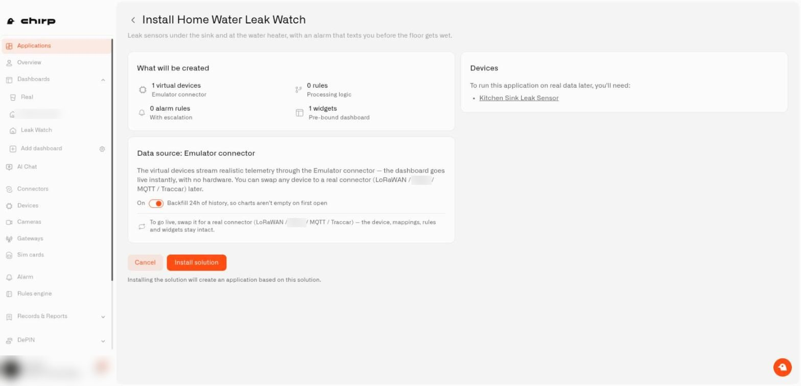
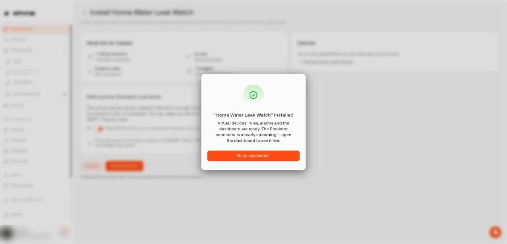

# Installing a Ready-Made Solution

You do not configure anything in advance. This page walks through the install screen element by element, then follows the install until you land inside your new application.

## How do I start the install?

Open a solution's preview and select **Use this solution** in the top-right corner. A page titled **Install** followed by the solution's name opens. The back arrow next to the title returns you to the preview.

## What is on the install screen?

* **What will be created** is a card with four tiles: the number of virtual devices (marked as running on the Emulator connector), rules (the processing logic), alarm rules (with escalation), and widgets (a pre-bound dashboard). This is the exact shopping list for your install.
* **Devices** is a card on the right that begins "To run this application on real data later, you'll need:" followed by the names of the practice devices. Each name is underlined; it stands for a real sensor you will connect later.
* **Data source: Emulator connector** explains that the practice devices stream realistic telemetry, that the dashboard is live instantly, and that you can swap any device to a real connector later.
* **Backfill 24h of history, so charts aren't empty on first open** is a switch labeled **On** or **Off**. It starts **On**. Leave it on to receive a day of earlier readings so charts already have a shape. Switch it off to start with an empty history.
* **Cancel** and **Install solution** sit at the bottom, with a note underneath saying that installing creates an application based on this solution.

<figure><figcaption>
The install screen before you press Install solution.
</figcaption></figure>

## What happens when I press Install solution?

The button changes to **Installing...** and the work runs in the background. Chirp builds, in this order, inside your organization:

1. An application named after the solution.
2. The practice sensors on the Emulator connector.
3. The alert definitions.
4. The automations, switched on and deployed.
5. The dashboards, collected in a folder named after the application, with every widget connected.

You can leave the page. The install keeps running, and when you return in the same browser the page picks up where it left off. After about a minute and a half you may see **Still installing, this can take a while — you can leave this page and check later.**

When it finishes, a message announces that the solution is installed ("Virtual devices, rules, alarms and the dashboard are ready"), and **Go to application** drops you into the application page.

<figure><figcaption>
The message you see when the install finishes.
</figcaption></figure>

## Who receives the alerts?

You do. Whoever the provider named while preparing the setup, the alerts in your copy are addressed to the person who installed it. Add household members or other channels later in [Alarm](../alarm/README.md).

## What if the install does not complete?

* **Not enough room on your plan.** A solution counts against your devices, dashboards, and rules, the same as things you create yourself, and practice sensors count as devices. If the total would exceed a limit, Chirp refuses before creating anything and names the limit. Free up room or change plans, then try again.
* **Missing permissions.** You need permission to create each kind of item. The message names the one that is missing.
* **An install is already running.** The message reads "Another installation of this solution is already running in your organisation, or a failed one needs an operator to clean it up before you can retry." (spelled as the product shows it). Choose **Go to my applications** to check.
* **The catalog is being updated.** Wait a minute and try again.
* **Installation failed** or **Installation cancelled** shows the reason and lets you try again.

If something goes wrong halfway, Chirp removes whatever it had already built so nothing half-finished is left. In the rare case it cannot, the message says **Installation failed and needs manual cleanup — contact support.**

Changed your mind? [Delete the application](deleting-an-application.md); only your copy goes away. Otherwise, continue with [From Practice Sensors to Real Ones](from-practice-sensors-to-real-ones.md).
