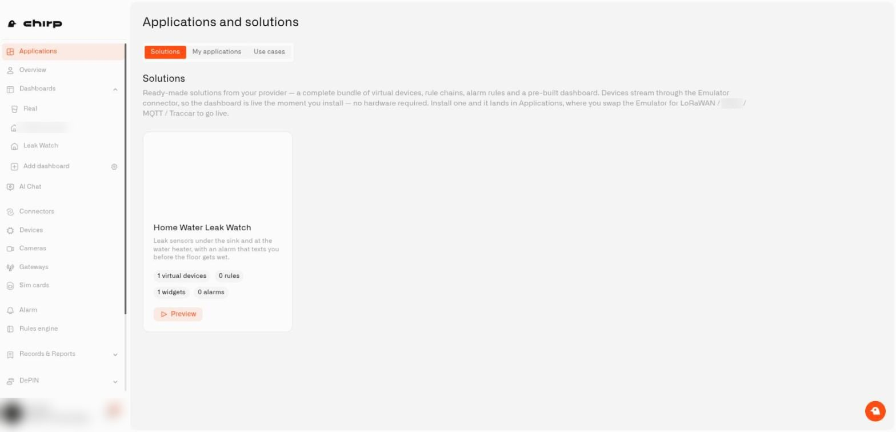

# What Are Solutions and Applications in Chirp?

A solution is a ready-made starting point, and an application is the setup that ends up in your account.

## What is a solution?

A **solution** is a ready-made setup we prepared for one specific job at home, like watching a holiday home or catching a leak early. It comes with the sensors, dashboard, automations, and alerts you would otherwise set up by hand. You find solutions on the **Solutions** tab, look them over, and install the ones you want.

## What is an application?

An **application** is what you have in your account after installing a solution: its sensors, dashboard, automations, and alerts, all in one place and already working. You can also create an application yourself and fill it with your own sensors and dashboards. Either way, you can edit it.

## What is the difference between a solution and an application?

Picture a family recipe and the dinner you cook from it. The solution is the recipe card, and the application is the dinner on your table. You pick a recipe, press **Install solution**, and end up with a dinner of your own.

* **After the install, there is no difference.** An application you built yourself and one that came from a solution behave identically. The installed one was simply set up for you, and it keeps its practice sensors until you swap them for real ones.

## Where do I find solutions and applications in Chirp?

Both live on one page. Choose **Applications** in the left sidebar. The page is called **Applications and solutions**, and two tabs sit under the title.

<figure><figcaption>
The Solutions tab, with the Applications item selected in the left sidebar.
</figcaption></figure>

| Tab | What it is for |
|---|---|
| **Solutions** | The catalog of ready-made solutions from Chirp. You preview and install them here. |
| **My applications** | All the applications in your organization: the ones you made yourself and the ones you installed. |

Guides for each tab:

* [How do I explore ready-made solutions?](exploring-ready-made-solutions.md)
* [How do I install a ready-made solution?](installing-a-ready-made-solution.md)
* [How do I create an application in Chirp?](creating-an-application.md)

## Who prepares the solutions?

Chirp prepares the solutions and keeps the catalog up to date, so you install solutions rather than publish them. Each one is a complete, ready-made setup for one job at home, such as leak protection or keeping an eye on a rental. New solutions arrive with every update.

## What is a use case?

A **use case** is the label for the problem a solution solves, such as leak protection or energy saving. One solution can cover several use cases, and the same use case can show up in more than one solution. You never need to manage use cases yourself.

## What is inside a solution?

| Part | What you get when you install it |
|---|---|
| Practice sensors | Sample sensors that send made-up readings, so the dashboard has something to show right away. Each carries an **Emulator** badge. |
| Automations | Rules that react to the readings, for example by sending an alert. They are already running. |
| Alerts | Notifications that tell you something needs attention, set up so that you are the one who gets them. |
| Dashboard | A ready-made view whose charts are already connected to the practice sensors. |

## What happens when a solution disappears or I delete an application?

* **A solution that leaves the catalog changes nothing for you.** If we take one out, it vanishes from the list. Applications that were already installed from it carry on working.
* **Deleting your application leaves the catalog alone.** It removes only your copy, and everything inside it. See [What happens when I delete an application?](deleting-an-application.md)

Can't find **Applications** in the sidebar? The feature may not be switched on for your account yet. See [Get Help](../help/get-help.md) to reach support.

