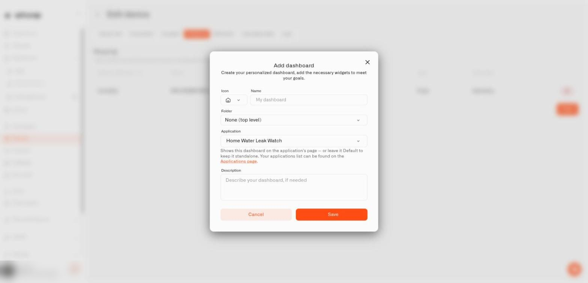

# How do I use an application's dashboards?

Open an application and its **Dashboard** tab shows your home at a glance, with live numbers and charts. **Content** is next door, and it lists the sensors, automations, and alerts that feed those screens.

Install a [solution](installing-a-ready-made-solution.md) and the dashboard comes along, already wired to the practice sensors. One application can hold more than one. A `Home Watch` application might have a dashboard for the whole house and a second one for the garden. To bring in a dashboard you built yourself, pick the application in the dashboard's **Application** field.

<figure><figcaption>
Pick the application in the Add dashboard dialog.
</figcaption></figure>

## How do I check my home from an application?

1. Select **Applications**, then open your application from **My applications**.
2. Choose the **Dashboard** tab.
3. If there is more than one dashboard, select the one you want. Each has a button above the preview with its name on it.
4. Look over the widgets. Use any controls your account allows.

Want to see which sensors or automations sit behind a number? Switch to **Content**.

## How do I change what a dashboard shows?

Select **Go to the dashboard**. That opens the dashboard itself, where you can rearrange the layout or add and remove widgets. Save when you are done.

You never work on a spare copy. The application and the dashboard page show the same thing, so your edit is there when you go back. The full walkthrough is in [Building a Dashboard](../dashboards/building-a-dashboard.md).

## Why is the Dashboard tab empty?

Open **Content** and look at the **Dashboards** card. Nothing in it? Then no dashboard has been linked to this application yet. Edit the dashboard you want and choose the application in its **Application** field. Or add a new dashboard and pick the application right there in the **Add dashboard** dialog.

A dashboard exists but you cannot open it? Ask the person who owns the account to check what you are allowed to see.

## What do the empty messages mean?

* **This application has no dashboards yet:** nothing has been linked to the application.
* **This dashboard has no widgets yet:** the dashboard is there, but it is still blank.
* **Dashboard is unavailable:** Chirp could not load it. Reload the page, then check your access.

## Why does the application page say Application not found?

You see **Application not found** alone in the middle of the screen, with no tabs and no buttons. Chirp cannot load that application. Common reasons:

* Someone deleted it.
* The link belongs to an application in a different organization.
* The page could not be read.

Choose **Applications** in the sidebar and open **My applications** to see what is available to you. Look at the organization selected in the sidebar too. An application lives in one organization only, and that is your Chirp account space.
