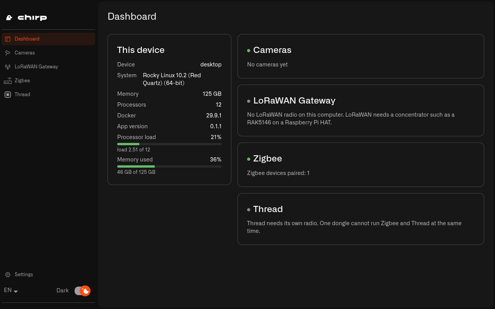
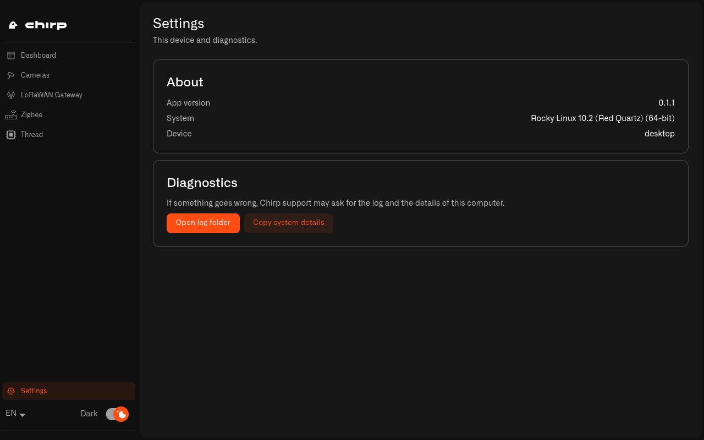

# What Is Chirp Hub?

Chirp is the app and website where you see and look after the devices in your home. You sign in to it with your Chirp account at [app.chirpwireless.io](https://app.chirpwireless.io). Chirp Hub is the part of Chirp that runs inside your house.

Why does it need a part in your house? Because the things Chirp looks after are there: the camera over the garage door, the leak sensor in the basement, the smart plug behind the TV. Many of them can't reach Chirp, or even each other, on their own. Something at home has to talk to them.

Chirp Hub is a free app you install on a computer that stays at home and is always on, like a Raspberry Pi on an open shelf in the hallway or the desktop PC in the study. It sets up the software your home devices need on that computer, and then keeps it running.

<figure><figcaption>
The Dashboard shows how busy the computer is and how far each part of your setup has got.
</figcaption></figure>

## What problem does Chirp Hub solve at home?

Each kind of device in your home needs its own piece of software running close to it:

* An IP camera (a camera that connects to your home network by cable or Wi-Fi) needs a recorder that saves its video and connects it to Chirp Lens, the part of Chirp where you watch your cameras.
* Zigbee devices need a Zigbee network. Zigbee is a short-range radio that many smart plugs, bulbs and door sensors use. It needs a radio stick plugged into the computer and a program that runs the network.
* LoRaWAN sensors need a gateway. LoRaWAN is a long-range radio for small battery sensors, like a soil sensor at the end of the garden, and the gateway is the receiver that picks up their signals and sends them to Chirp.

Setting these up by hand means installing the recording software for every camera, working out which port your Zigbee stick is on and writing its settings file, and copying the gateway's security certificates into the right folders, all by typing commands.

With Chirp Hub, most of that goes away. On a Windows, Mac or Linux computer, you install the app and that's it. A Raspberry Pi takes a little more: during its first setup you copy a handful of commands from the [Raspberry Pi guide](raspberry-pi/setup.md), one time only. After that, you work in the app. You plug in the hardware, Chirp Hub spots the camera, the Zigbee stick or the LoRaWAN card, and each one gets a page in the app where you finish the setup. On the **Cameras** page that starts with **Scan for cameras**. On the **Zigbee** page it starts with **Start Zigbee**.

## What can Chirp Hub set up?

| What | What Chirp Hub does for you | What you get | Where it works |
|---|---|---|---|
| **Cameras** | Finds the IP cameras on your home network and starts a recorder for each one. The recorder is called a [Twin](../lens/installing-twin.md) | Your cameras in Chirp Lens, signed in with your Chirp account | Raspberry Pi and computers |
| **Zigbee** | Finds your Zigbee USB stick, starts a Zigbee network with its own security key, and lets you pair new devices | Your Zigbee devices paired, controlled and showing their readings right on the hub: on the **Zigbee** page and in the Zigbee2MQTT dashboard | Raspberry Pi or a Linux PC, not Windows or Mac |
| **Thread** | Runs a Thread border router. Thread is a low-power radio used by many Matter devices. Matter is a shared standard that lets smart home devices from different brands work together | A Thread network in your home for your Matter devices | Raspberry Pi |
| **LoRaWAN gateway** | Turns a Raspberry Pi with a LoRaWAN card into a gateway and installs the certificates Chirp gives you for it | Your LoRaWAN sensors in Chirp | Raspberry Pi with a LoRaWAN card |

The gateway row is only for building your own. Most people buy a ready-made LoRaWAN gateway instead, which doesn't need Chirp Hub. [Should I make my Raspberry Pi a LoRaWAN gateway too?](raspberry-pi/README.md#should-i-make-my-raspberry-pi-a-lorawan-gateway-too) compares the two.

You only set up the parts you need. Each one has its own page in the app's left menu. When something isn't connected yet, its page is still there and says which hardware it's waiting for.

## Should I run Chirp Hub on a Raspberry Pi or a PC?

Both work. The choice comes down to how many cameras you have and which radios you want.

A Raspberry Pi is an inexpensive computer not much bigger than a deck of cards. It uses very little power, so leaving it on day and night is no problem. It's the only option that can run Thread, and the only one you can build your own LoRaWAN gateway on. A Raspberry Pi 4 can record about six or seven cameras. Read [Raspberry Pi](raspberry-pi/README.md) to build one.

A Windows, Mac or Linux computer has more power, so it can record many more cameras. How many depends on its processor, memory and network. That suits a big house with a camera on every side, or a holiday rental you keep an eye on from home. Zigbee works on a Pi or a Linux PC, not on Windows or Mac. A computer has nowhere to fit a LoRaWAN card, so with LoRaWAN sensors you'd use a [ready-made gateway](../gateways/lorawan-gateways/compatible-lorawan-gateways.md) alongside it. Read [Windows, Mac and Linux](computer.md) for the details.

## How do I get started with Chirp Hub?

1. Make sure you can sign in to Chirp at [app.chirpwireless.io](https://app.chirpwireless.io). You need your account to watch your cameras in Lens and to register a gateway.
2. Decide which computer will stay at home and run Chirp Hub: a Raspberry Pi or a computer you already have.
3. [Download and install Chirp Hub](download-and-install.md). A Raspberry Pi needs a little preparation first, which the [Raspberry Pi guide](raspberry-pi/README.md) walks you through.
4. Open Chirp Hub. The **Dashboard** shows the computer it's running on and a card for each thing it can set up.
5. In the left menu, pick what you want to set up first and follow its guide: [Cameras](cameras.md), [Zigbee](zigbee.md), [Thread](thread.md) or the [LoRaWAN gateway on a Raspberry Pi](raspberry-pi/lorawan-gateway.md).

Before you add another camera, look at the **Processor load** and **Memory used** bars on the Dashboard. They turn orange when the computer is getting full.

## Where do I find my Chirp Hub version and logs?

Open **Settings** at the bottom of the left menu. It shows which version of Chirp Hub you have, the operating system, and the kind of device it's running on.

<figure><figcaption>
Settings shows the version number, and the diagnostics section is where support will send you.
</figcaption></figure>

If something goes wrong and you contact support, they'll usually ask for two things from this page:

* **Open log folder** opens the folder where Chirp Hub writes its log files.
* **Copy system details** copies the version, the operating system and the hardware details, so you can paste them into your message.

## How do I keep Chirp Hub running at home?

* Use a computer that never gets switched off. Cameras only record, and Zigbee devices only report to the hub, while Chirp Hub's computer is on.
* Give it a spot with some air around it, not a closed cupboard. A computer that runs hot slows down when the cameras are busy.
* Plug it into your router with a network cable if you can. Cameras send video all day and night, and a cable keeps the recordings free of gaps.
* To change the language, use the language selector at the bottom of the menu. Chirp Hub speaks English, German, French, Spanish and Portuguese. The **Dark** switch changes the theme.

Next: [How Do I Download and Install Chirp Hub?](download-and-install.md)
