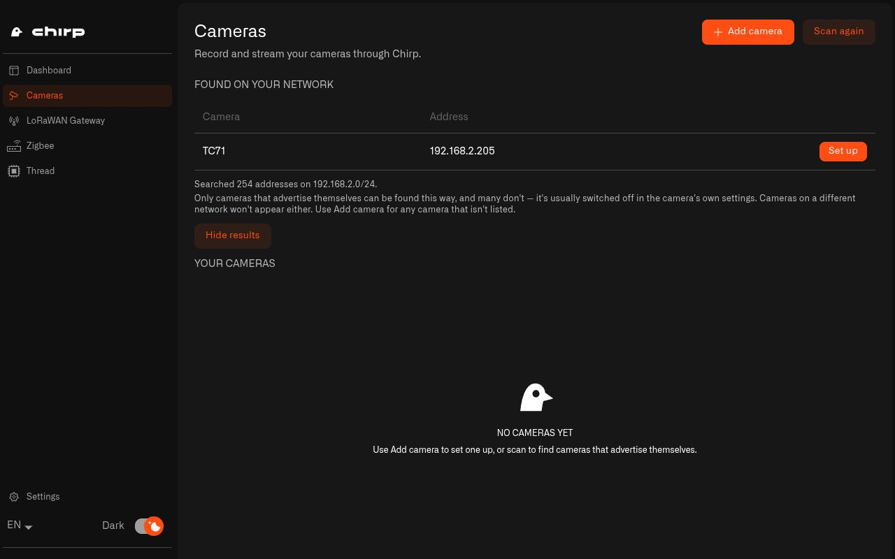

# How Do I Connect Home IP Cameras to Chirp Hub?

An IP camera is a camera that connects to your home network, by cable or Wi-Fi. Chirp Lens is the part of Chirp where you watch those cameras, signed in with your Chirp account at [app.chirpwireless.io](https://app.chirpwireless.io). For Lens to see a camera, something in your house has to take the camera's video, record it and connect the camera to Lens. That job is done by a [Twin](../lens/installing-twin.md), a small recorder program, with one Twin for each camera.

Chirp Hub sets up a Twin for every camera you add. You don't have to type any Docker commands or keep track of version numbers and ports.

## Why add my cameras through Chirp Hub?

Each Twin runs in its own Docker container, the sealed-off box Docker uses to run a program. Done by hand, every camera needs a container with its own name, its own storage, a free port and the right version. With a doorbell camera, a garden camera and a garage camera, that's already three containers to keep track of. Chirp Hub creates and looks after every one of them, installs Docker if the computer doesn't have it, and shows all your cameras and how they're doing on one page.

## How do I find the cameras on my home network?

1. Open **Chirp Hub** and choose **Cameras** in the left menu.
2. Select **Scan for cameras**. Chirp Hub searches your home network for about twenty seconds.
3. Each camera that announces itself on the network appears under **Found on your network**, with its name and address.

<figure><figcaption>
After a scan, every camera that announced itself is listed and ready to set up.
</figcaption></figure>

A camera announces itself through a standard called ONVIF. The scan only finds a camera if ONVIF discovery is turned on in the camera's own settings and the camera is on the same network as the hub. If a camera doesn't show up, add it with **Add camera** instead.

## How do I set up a camera the scan found?

1. Select **Set up** next to the camera. Chirp Hub goes through three steps and shows each one as it works: **Docker**, **Camera software** and **Your camera**. The camera software only downloads once, with your first camera. After that, each new camera is ready in seconds.
2. Once **Your camera is ready.** appears, note the username and password next to it.
3. Select **Open camera**. The camera's Twin opens in your web browser, which on a Raspberry Pi is Firefox.
4. Sign in with the username and password from Chirp Hub. On that first sign-in, the Twin makes you pick a new password of your own. From then on, the username and password Chirp Hub gave you no longer work.
5. Finish inside the Twin: add the camera's video stream and link it to Lens. [Connecting a Camera](../lens/connecting-a-camera.md) shows how.

## How do I add a camera the scan can't find?

1. Select **Add camera**. A new camera is created straight away and named with the next number, like Camera 2.
2. Chirp Hub shows **Open your new camera and choose which camera it records.** with the sign-in details underneath.
3. Select **Open camera** and sign in. In the Twin, type the camera's stream address. The stream address is the link the camera's live video comes from, usually starting with `rtsp://`. Until you enter it, the **Address** column says **Set in camera setup**. [RTSP Camera URLs](../lens/rtsp-camera-urls.md) lists the stream address for many camera brands.

## What happens if Docker isn't installed?

Cameras need Docker. If it's missing or stopped, Chirp Hub explains what it's going to do and shows one of these, depending on what's missing: **Install Docker and add camera**, **Start Docker and add camera** or **Fix permissions and add camera**. Select it, and Chirp Hub finishes adding the camera by itself.

* **Windows:** Chirp Hub downloads and installs Docker Desktop. Approve the administrator prompt. Your PC may need to restart, and Chirp Hub opens again afterwards and finishes adding the camera.
* **macOS:** Chirp Hub sets up a Docker of its own (about 400 MB). There's no password to enter and nothing new in Applications.
* **Linux and Raspberry Pi:** Chirp Hub installs Docker Engine and asks for your password.

## How do I manage or remove a camera?

Each camera under **Your cameras** has three options:

* **Open camera** opens that camera's Twin in your browser.
* **Sign-in details** shows the first sign-in details again. They only help until you've signed in and chosen your own password. After that, use your own password.
* **Remove** asks what to do with the recordings. **Remove, keep recordings** stops the camera but leaves its video on the computer. **Remove and delete recordings** deletes the video as well.

## How many cameras can Chirp Hub record?

That depends on the computer Chirp Hub runs on. On a [Raspberry Pi](raspberry-pi/README.md) 4, expect about six or seven cameras alongside everything else it runs. On a [computer](computer.md), the limit is its processor, memory and network, so a home with lots of cameras is better off running Chirp Hub on a PC. To see how much room is left, watch **Processor load** and **Memory used** on the Dashboard.

## How do I get the most out of my home cameras?

* Turn on ONVIF discovery in each camera's settings, so the scan finds it.
* On a Raspberry Pi, check **Processor load** on the Dashboard before adding another camera. A Pi 4 tops out at about six or seven. If you need more, run Chirp Hub on a [computer](computer.md).
* Save the password you choose at the first sign-in somewhere safe, like a password manager your family shares. Chirp Hub doesn't keep a copy.

Next: [How Do I Pair Zigbee Devices with Chirp Hub?](zigbee.md)
