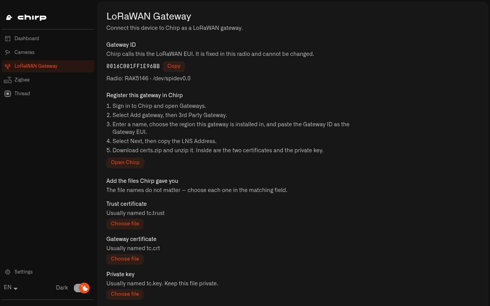
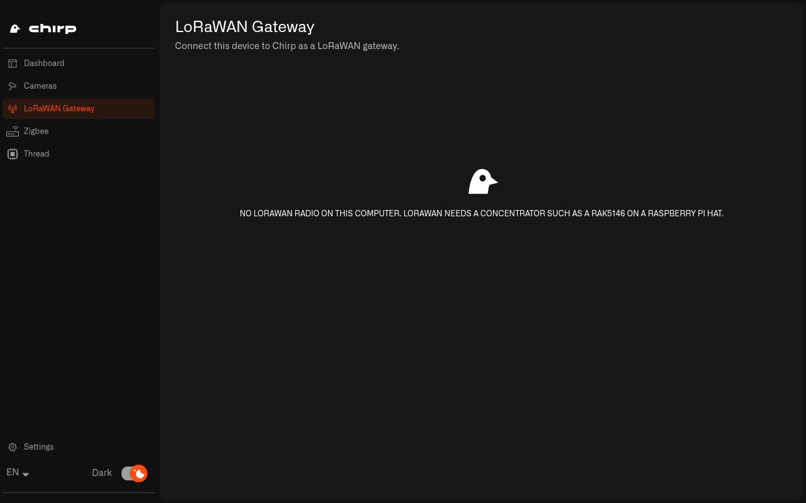

# How Do I Use a Raspberry Pi as a LoRaWAN Gateway?

This page is only for a Raspberry Pi with a LoRaWAN concentrator card fitted. If your Pi doesn't have one, you can skip it.

A LoRaWAN gateway is the receiver for your LoRaWAN sensors, such as a leak sensor in the basement or a soil sensor in the garden. It picks up their radio signals and sends them over the internet to Chirp. Most people buy a ready-made gateway and set it up with [Setting Up a LoRaWAN Gateway](../../gateways/lorawan-gateways/setting-up-a-lorawan-gateway.md). This page is for the other option, building your own on a Raspberry Pi, which [the Raspberry Pi guide](README.md#should-i-make-my-raspberry-pi-a-lorawan-gateway-too) compares with buying one.

With the card fitted and the setup script run, your Pi already has everything it needs to be a gateway. What's left is to register it in your Chirp account and give it the certificates Chirp creates for it. Certificates are small files that prove to Chirp that the gateway really is yours, and they keep the connection between the two encrypted. Chirp Hub walks you through both steps, and you don't have to edit any settings files. [LoRaWAN Gateways](../../gateways/lorawan-gateways/README.md) explains how gateways work in Chirp in general.

## What do I need before I start?

* A Raspberry Pi with the RAK5146 card and a LoRa antenna, bought from the [shopping list](shopping-list.md), [put together](hardware.md) and [set up with the script and Chirp Hub](setup.md). The setup script must have found the card.
* Your Chirp account at [app.chirpwireless.io](https://app.chirpwireless.io), where you can open **Gateways**.
* The LoRaWAN region you live in, for example EU868 in Europe or US915 in North America.
* An internet connection on the Pi.

## How do I connect my Raspberry Pi gateway to Chirp?

1. On the Pi, open **Chirp Hub** and choose **LoRaWAN Gateway** in the left menu. You'll see the **Gateway ID**, which Chirp Hub reads from the card. Chirp calls the same number the Gateway EUI.
2. Select **Copy** next to the Gateway ID, then select **Open Chirp**. On the Pi, Chirp opens in Firefox at [app.chirpwireless.io](https://app.chirpwireless.io). Sign in with your Chirp account.
3. In Chirp, go to **Gateways**, select **Add gateway**, and choose **3rd Party Gateway**.
4. Enter a name such as "Basement Gateway", choose the region you live in, and paste the Gateway ID into **Gateway EUI**. Select **Next**.
5. Copy the **LNS Address**. That's the internet address of Chirp's LoRaWAN server, the one your gateway connects to. Then download **certs.zip**.
6. Unpack **certs.zip**. On the Pi, click it in Firefox's list of downloads. It opens in the archive tool, where you choose **Extract**. On a Windows or Mac computer, unzip it the way you normally would. Either way, you get three files: `tc.trust` (the trust certificate), `tc.crt` (the gateway certificate) and `tc.key` (the private key).
7. Back in Chirp Hub, under **Add the files Chirp gave you**, use **Choose file** to pick each file for **Trust certificate**, **Gateway certificate** and **Private key**. Then paste the address into **LNS address**.
8. Select **Save** and enter your Pi password when asked. Chirp Hub checks that the three files belong together, installs them, and starts the gateway.
9. When you see **This gateway is set up and running.**, select **Open Chirp** and watch the gateway come online under **Gateways**.

<figure><figcaption>
Copy the Gateway ID, register the gateway in Chirp, then add the files Chirp gives you.
</figcaption></figure>

If the files don't match, for example because they come from two different downloads or the private key has a password on it, Chirp Hub won't install them and tells you which file to pick again. If saving fails, Chirp Hub tries to put the previous files back. If the page then says **This gateway is only part-way set up.**, choose all three files again and select **Save**.

Keep `certs.zip` and the three files private. Anyone who has them can pretend to be your gateway. If they end up in the wrong hands, make fresh certificates in Chirp and load those into Chirp Hub instead.

## How do I know my gateway is connected to Chirp?

Chirp Hub can only check what's on the Pi: that the files are in place and the gateway software is running. Whether the gateway has actually reached Chirp, you see in Chirp. Open the gateway under **Gateways** in Chirp and look at its status and traffic. [Checking LoRaWAN Gateway Health](../../gateways/lorawan-gateways/checking-lorawan-gateway-health.md) explains what to look for.

When the gateway software isn't running, the page shows **This gateway is set up but not running.** Selecting **Start gateway** brings it back.

## Why does the LoRaWAN Gateway page say there is no LoRaWAN radio?

The page only works on a Pi that has the card fitted and has been through the setup script. On a Pi without a card, on a regular computer, or on a Pi where the script couldn't find the card, it tells you which hardware it needs.

<figure><figcaption>
With no LoRaWAN card, the page tells you which hardware to add.
</figcaption></figure>

If you have a card fitted, run the setup script again. Still no card found? Follow [the troubleshooting steps](troubleshooting.md#what-if-the-setup-script-says-the-concentrator-did-not-answer).

## How do I get the best range from my Raspberry Pi gateway?

* Put the antenna as high as you can, and never inside a metal cabinet. Where the antenna sits affects range far more than the gateway does.
* Keep the Pi itself out of a closed cabinet, too. It needs some air.

Once the gateway is online, add your LoRaWAN sensors in Chirp as described in [LoRaWAN Devices](../../devices/lorawan-devices.md). The Pi passes their readings on like any other gateway, and you see them in Chirp.

Next: [How Do I Connect Home IP Cameras to Chirp Hub?](../cameras.md)
