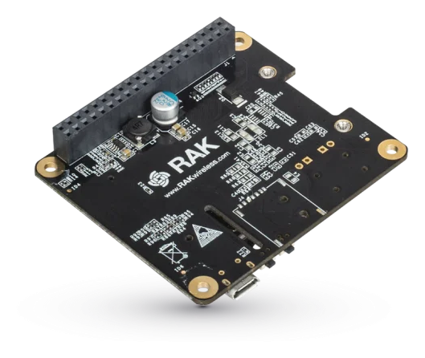
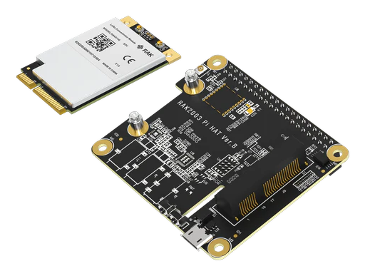

# What Parts Do I Need for a Raspberry Pi Hub?

Every Raspberry Pi hub starts with the same few things: the Pi, a power supply, a memory card, a case and a network cable. After that, you only buy what you want the hub to do. If you only want to record your cameras, you don't need any radios. If you only want Zigbee, you need one USB stick. The LoRaWAN parts are only for building your own LoRaWAN gateway on the Pi. Everything on this page is a standard part you can buy online.

## What do I need for the Raspberry Pi itself?

| Part | What to buy | Why |
|---|---|---|
| Raspberry Pi | A Raspberry Pi 5 with 4 GB of memory or more, or a Raspberry Pi 4 Model B with 4 GB or 8 GB | It runs Chirp Hub. A Pi 5 can record more cameras than a Pi 4 |
| Power supply | The official Raspberry Pi USB-C power supply for your board: 27 W (5 V / 5 A) for a Pi 5, 15 W (5 V / 3 A) for a Pi 4 | A phone charger often can't deliver enough power. The Pi then restarts when it gets busy, which looks like random faults |
| microSD card | 32 GB or more, A2 rated, from a well-known brand | It holds the operating system and your camera recordings. A card made for constant writing lasts longer |
| Case | One with good airflow, ideally with a fan. If you're building a LoRaWAN gateway, get one tall enough for a Pi HAT, with a hole for the antenna connector | Most Pi cases are too short once a HAT sits on top |
| Network cable | Cat 5e or better | A cable to your router keeps the hub and the cameras online when your Wi-Fi isn't |
| For the setup | A microSD card reader for your computer. For the Pi: a screen and an HDMI cable (the Pi has micro-HDMI ports), a USB keyboard and a mouse | You use the card reader to put the operating system on the card, and the screen and keyboard to use Chirp Hub on the Pi |

That's all you need for a hub that records cameras.

## What do I need to record my cameras?

| Part | What to buy |
|---|---|
| IP cameras | Any camera with ONVIF and RTSP support. ONVIF lets a camera announce itself on your network so the hub can find it, and RTSP is the way it sends its live video. Most IP cameras sold today have both. A Raspberry Pi 4 can record six or seven of them. If you have more, a computer running Chirp Hub can record more |
| Power for the cameras | If a camera is powered over its network cable (PoE, short for Power over Ethernet), you need a PoE switch, or a PoE injector for each such camera |

## What do I need for Zigbee and Thread devices?

Buy these if you want Zigbee smart plugs, bulbs and door sensors, or Matter devices that use Thread.

| Part | What to buy | Why |
|---|---|---|
| Zigbee USB stick (coordinator) | Pick a stick from the list on the [Zigbee](../zigbee.md#which-zigbee-coordinators-does-chirp-hub-recognize) page, since those are the ones Chirp Hub recognizes. Popular ones are the SONOFF ZBDongle-E and Zigbee Dongle Plus MG24 and the Home Assistant Connect ZBT-1 | It's the radio that runs your Zigbee network, which is why it's called the coordinator |
| Thread radio | A USB radio stick sold with Thread firmware (OpenThread RCP) already on it, such as a Nordic nRF52840 dongle with that firmware. Putting Thread firmware on a stick yourself is a do-it-yourself job | Thread needs a radio of its own. One stick can't run Zigbee and Thread at the same time |
| USB extension cables | Two short ones | They keep each radio away from the Pi and its USB 3 ports, whose electrical noise disturbs 2.4 GHz radio signals |

## What do I need to build my own LoRaWAN gateway on a Raspberry Pi?

Only buy these to build your own gateway. Most people with LoRaWAN sensors buy a [ready-made gateway](../../gateways/lorawan-gateways/compatible-lorawan-gateways.md) instead and skip this section; [the Raspberry Pi guide](README.md#should-i-make-my-raspberry-pi-a-lorawan-gateway-too) compares the two.

Two of the parts need a word of explanation. The **concentrator card** is the LoRaWAN radio itself: a small card that listens for your sensors on many radio channels at once. The **Pi HAT** is an adapter board that plugs onto the row of pins along the edge of the Raspberry Pi and holds the concentrator card.

| Part | What to buy |
|---|---|
| Pi HAT | RAKwireless RAK2287/RAK5146 Pi HAT, which holds the concentrator card on the Pi's 40-pin header |
| Concentrator card | RAKwireless RAK5146 in mPCIe format, **SPI** version, for your region's radio band: 868 MHz for Europe, 915 MHz for North America and Australia. You can get a version with GPS if you want it |
| Antenna | A LoRa antenna for that same band, with an SMA or RP-SMA connector |
| Antenna cable | An iPEX (MHF4) to SMA pigtail, which brings the card's antenna connector out through the case |

The easiest option is the **RAK5146 Pi HAT kit**. The HAT and the card come in one box, already matched to each other. RAKwireless and electronics stores sell all of these parts.

<figure><figcaption>
The Pi HAT sits on top of the Raspberry Pi and holds the concentrator card.
</figcaption></figure>

<figure><figcaption>
The RAK5146 card. One connector is for the LoRa antenna. The other, marked GPS, is for the optional GPS antenna.
</figcaption></figure>

<figure><figcaption>
The RAK5146 Pi HAT kit has the card and the HAT in one box.
</figcaption></figure>


Buy the card and the antenna for the radio band of the country you live in. You can't change the band later. The other region settings are picked in Chirp when you register the gateway.


## Can I start small and add parts later?

Yes. Start with the Pi and its basics plus the one thing you want first, such as your cameras. You can add a Zigbee stick, a Thread radio or the LoRaWAN parts whenever you like.

If you buy the LoRaWAN parts, keep the antenna's box. It shows the band, and you need to know it when you register the gateway in Chirp.

Next: [How Do I Assemble a Raspberry Pi Smart Home Hub?](hardware.md)
