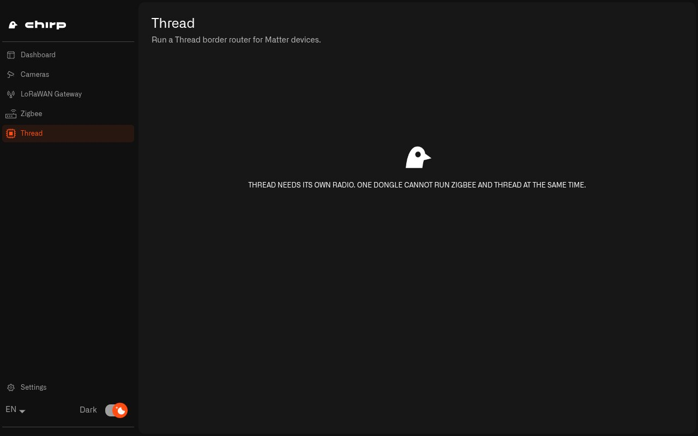

# How Do I Add Thread to Chirp Hub?

Matter is a shared smart home standard that lets sensors, door locks, blinds and bulbs from different brands can work together. Many Matter devices use Thread to talk: a low-power radio network, a bit like Zigbee, where the devices pass messages along for each other.

A Thread network needs a border router: something that links the Thread devices to the rest of your home network. On a Raspberry Pi, Chirp Hub runs that border router for you. All you add is a USB radio stick for Thread.

## Why does Thread need its own radio?

Zigbee and Thread use the same kind of 2.4 GHz radio chip, but each needs different firmware, the software built into the stick. One stick can only run one of them at a time. So if your home uses both, you need two USB radio sticks: one with Zigbee firmware for your [Zigbee](zigbee.md) network, and one with Thread firmware. Chirp Hub keeps the two apart, so your Thread radio is never mistaken for the Zigbee stick, or the other way round.

## Which radio do I need for Thread?

Buy a USB radio stick that's sold with Thread firmware already on it. The firmware to look for is called OpenThread RCP. A Nordic nRF52840 dongle is a common choice.

Many sticks sold for Zigbee can also be reflashed with Thread firmware, using the firmware and instructions from the stick's maker. That's a do-it-yourself job, so if you'd rather not, buy one that already has Thread firmware.

## How do I set up Thread on a Raspberry Pi?

If you set up your Pi with the [setup script](raspberry-pi/setup.md#how-do-i-get-the-pi-ready-for-the-lorawan-card-and-radios), the Thread border router (OpenThread) is already installed. It starts by itself once a radio stick has been given the Thread job.

1. Plug the Thread stick into a free USB port. If you also have a Zigbee stick, the two can sit side by side.
2. Find its USB serial number. At a command prompt on the Pi (for example over SSH from your computer, as on the [setup page](raspberry-pi/setup.md)), run:

   ```sh
   ls /dev/serial/by-id
   ```

   You get one line per radio stick. A line looks like this one, from a SONOFF stick:

   ```
   usb-SONOFF_SONOFF_Dongle_Plus_MG24_f620d69ac39aef11aa72ad9061ce3355-if00-port0
   ```

   The serial number is the part after the last underscore and before `-if00`. In this example, that's `f620d69ac39aef11aa72ad9061ce3355`. Copy it from the line for your Thread stick.
3. Give it the Thread job. You only do this once:

   ```sh
   sudo iot-hub-radio-assign <usb-serial> thread
   ```

   The command checks that the radio is plugged in and isn't already your Zigbee stick, sets it up as the Thread radio, and starts the border router. The job is tied to the serial number, so it stays after restarts and in any USB port.
4. Open **Chirp Hub** and choose **Thread** in the left menu. You should see **Thread radio found.**

That's where Chirp Hub's part ends: it keeps the Thread border router running for your home. Chirp Hub doesn't add Matter devices and doesn't list them, so the Thread page has nothing more for you to do. To add a Matter device, follow the setup steps in the device's own manual.

Without a Thread radio, the Thread page and the Thread card on the Dashboard both tell you that Thread needs its own radio, because one stick can't run Zigbee and Thread at the same time.

<figure><figcaption><p>With no Thread radio plugged in, the page reminds you that Zigbee and Thread each need their own stick.</p></figcaption></figure>

Chirp Hub can't use USB radio sticks on Windows or macOS, so Thread needs a Raspberry Pi.

## How do I keep my Zigbee and Thread radios from getting mixed up?

* Put a label on each stick. They often look exactly the same, and plugging in the Zigbee stick where the Thread one should be is the most common reason the Thread page can't find a radio.
* Use a short USB extension cable for each, and keep them a little apart from each other and from the computer's Wi-Fi antenna.

Next: [Why Is My Raspberry Pi Hub Not Working?](raspberry-pi/troubleshooting.md)
