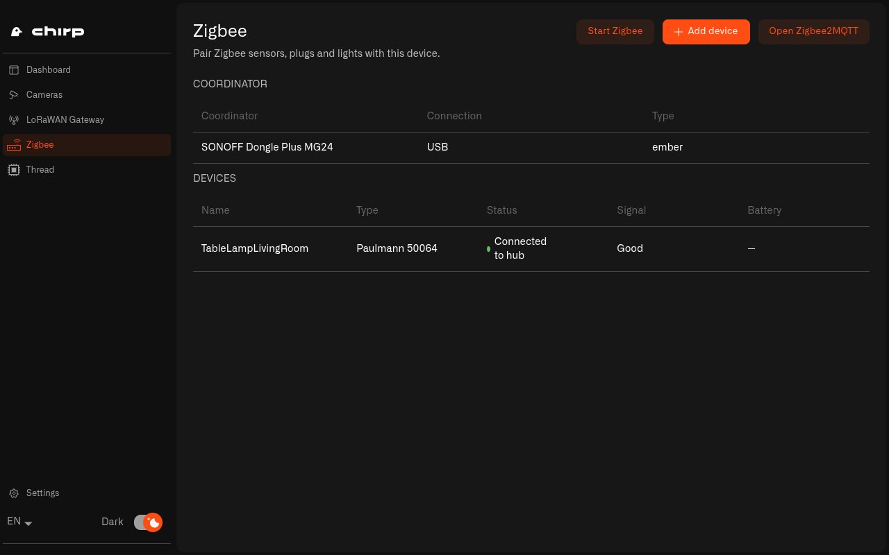
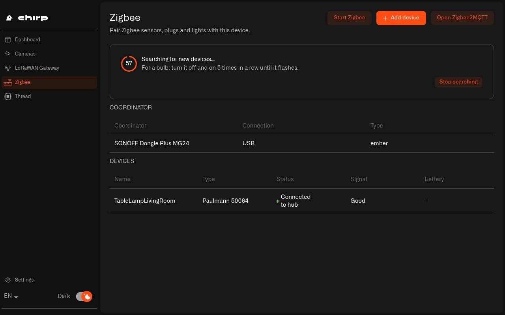
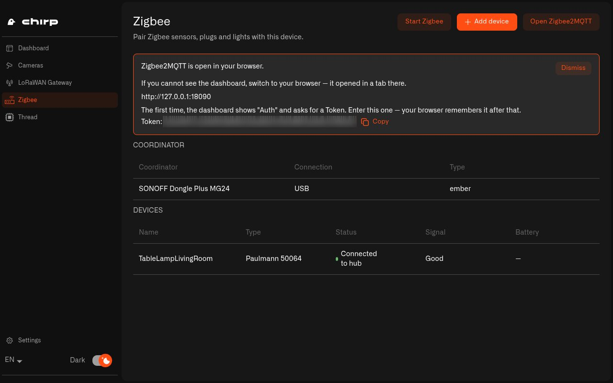

# How Do I Pair Zigbee Devices with Chirp Hub?

Zigbee is a short-range radio that lots of smart home devices use: smart plugs, bulbs, door sensors, motion sensors and leak sensors. Zigbee devices don't connect to your Wi-Fi. They talk to each other and to a Zigbee USB stick, called the coordinator, which runs your Zigbee network.

Chirp Hub turns that USB stick into a working Zigbee network for your home. It recognizes the stick, starts the network with a security key of its own, and lets you pair new devices from the app. Behind the scenes it runs Zigbee2MQTT, a widely used free program for Zigbee networks. Zigbee works on a Raspberry Pi or a Linux PC, not on Windows or Mac.

## Why set up Zigbee with Chirp Hub?

Setting up Zigbee2MQTT yourself means finding out which port the stick is on and which driver its chip needs, creating a network key and writing a settings file by hand. If you pick the wrong driver, the error message doesn't tell you much. Chirp Hub reads all of that from the stick itself, keeps it working after a restart or when you plug in other USB devices, and creates a new network key for your home instead of using a shared default.

## Which Zigbee coordinators does Chirp Hub recognize?

Chirp Hub knows these USB Zigbee sticks and picks the right driver for each one by itself:

* SONOFF ZBDongle-E, ZBDongle-P and Zigbee Dongle Plus MG24
* Home Assistant Connect ZBT-1 and SkyConnect
* SMLIGHT SLZB-06P, SLZB-06MU, SLZB-07 and SLZB-07P
* dresden elektronik ConBee and RaspBee

Plug in the stick before you open the **Zigbee** page. If it's the only radio stick, Chirp Hub uses it for Zigbee automatically.

If you have two or more plugged in, for example a Zigbee stick and a Thread radio, Chirp Hub doesn't guess. They show up under **Radios needing a decision**. Select **Use for Zigbee** on the one that's meant for Zigbee. Chirp Hub remembers that stick by its serial number, so it keeps the job after a restart and in any USB port.

If no stick is found, the page says **No Zigbee coordinator found. Plug in a supported USB dongle and it will appear here.**

## How do I start my Zigbee network?

1. Open **Chirp Hub** and choose **Zigbee** in the left menu. The **Coordinator** table shows your stick, its **Connection** (USB) and its **Type**, which is the driver Chirp Hub picked.
2. Select **Start Zigbee**. Chirp Hub starts the network and waits until it reports that it's online. The first time, this can take up to a minute.
3. When you see **Zigbee started.**, your network is running. Any devices you paired before are listed in the **Devices** table.

<figure><figcaption>
Your Zigbee stick and every paired device, with its signal and battery, on one page.
</figcaption></figure>

If your devices stop answering, select **Start Zigbee** again. If Zigbee isn't running properly, this restarts it, so it's the first thing to try.

## How do I pair a Zigbee device?

1. Select **Add device**. Your network starts accepting new devices, and a countdown shows how long it stays open.
2. While **Searching for new devices…** is on screen, put your device into pairing mode. On most sensors you hold down a small button for a few seconds. A smart bulb usually needs to be switched off and on five times in a row until it flashes. The device's manual has the exact steps.
3. As soon as it joins, the **Devices** table lists it, with columns for its name, **Type**, **Status**, **Signal** and **Battery**. A green **Connected to hub** means it's part of your Zigbee network.
4. When you've paired everything, select **Stop searching**, or let the countdown run out. Either way, the network stops accepting new devices.

<figure><figcaption>
Put your device into pairing mode while the countdown runs.
</figcaption></figure>

If Zigbee isn't running yet, **Add device** asks you to start it first.

## How do I open the Zigbee2MQTT dashboard?

Zigbee2MQTT has its own dashboard. There you can rename devices, see every value they send, turn lights and plugs on and off, update their firmware and see a map of your network. Chirp Hub opens it for you.

1. Select **Open Zigbee2MQTT**. The dashboard opens in a tab of your web browser, which on a Raspberry Pi is Firefox.
2. The first time, the dashboard shows **Auth** and asks for a **Token**. You'll find the token in Chirp Hub, below **Zigbee2MQTT is open in your browser.** Select **Copy**, then paste it into the dashboard. Your browser remembers it after that.

<figure><figcaption>
Chirp Hub shows where the dashboard is and the token it asks for the first time.
</figcaption></figure>

Every home gets its own token, and only the computer running Chirp Hub can open the dashboard.

## How does Zigbee work on a Raspberry Pi hub?

If you set up your Pi with the [setup script](raspberry-pi/setup.md), Zigbee runs in the background on the Pi itself:

* The first time you select **Start Zigbee**, Chirp Hub asks for the Pi's password once. It needs it to give the stick its Zigbee job and create the network settings.
* From then on, Zigbee comes back up on its own whenever the Pi boots, whether or not a screen is attached.
* The stick's job is tied to its serial number, so you can move it to another USB port.

## How do I get a strong Zigbee network at home?

* Pair each device where it's going to stay. Devices that are always plugged in, like smart plugs and bulbs, pass messages along for the others, so set those up first and battery sensors afterwards.
* Connect the Zigbee stick with a short USB extension cable, away from USB 3 ports and the computer's Wi-Fi.
* In the Zigbee2MQTT dashboard, give your devices names everyone at home understands, like "Kitchen plug" or "Basement leak sensor". Chirp Hub shows the same names.

## Where do I see and control my Zigbee devices?

Your Zigbee devices live on the hub, and you look after them in two places on the computer running Chirp Hub:

* The **Zigbee** page in Chirp Hub lists every paired device with its **Status**, **Signal** and **Battery**, and it's where you pair new ones.
* The Zigbee2MQTT dashboard, opened with **Open Zigbee2MQTT**, shows every reading your devices send and lets you switch lights and plugs on and off, rename devices and update their firmware.

Next: [How Do I Add Thread to Chirp Hub?](thread.md)
