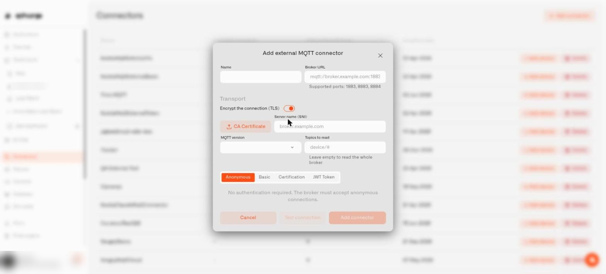

# External MQTT

External MQTT lets Chirp receive readings from a broker you already run. The **broker** is the server that collects MQTT messages from your devices or Zigbee2MQTT bridge. Chirp connects to that server and subscribes to the message channels you configure.

Use this route if your home already has a broker you want to keep. You need its address, the appropriate login details, and a network path that Chirp can reach. If you would prefer Chirp to manage the broker, choose [Cloud MQTT](cloud-mqtt.md). Either route still needs [device registration and topic mapping](topics-and-device-routing.md).

## How the connection works

The most important thing to understand up front: **Chirp connects out to your broker**, not the other way around. This single fact decides everything that follows.

Practically that means your broker must be reachable from the public internet — Chirp's cloud needs to dial it. A broker running on `192.168.1.50:1883` on your home network is invisible to Chirp. Tunnels and port-forwarding fix that, with the trade-off that running an exposure tool such as ngrok does not by itself confirm Chirp can reach the broker — you must publish a test message after saving and verify the connector's **Last data received** field updates.

If your broker is already on a VPS or a cloud account, you're set — point Chirp at the public hostname and you're done.

## When to choose External MQTT

- You already run Mosquitto, HiveMQ Cloud, or another broker, and you want Chirp to consume from it without rerouting devices.
- Your home automation setup (Home Assistant, Node-RED) is already publishing to a broker, and Chirp is one more subscriber.
- You want Chirp to share data with other consumers — your dashboards, your scripts, your local NAS — through one common bus.

If none of those apply, [Cloud MQTT](cloud-mqtt.md) is simpler.

## Setting up Mosquitto on a home server

Mosquitto is the most common open-source broker for home use. The minimal Docker setup looks like this:

`~/mqtt/docker-compose.yml`:
```yaml
services:
  mosquitto:
    image: eclipse-mosquitto:2
    container_name: mosquitto
    restart: unless-stopped
    ports:
      - "1883:1883"
    volumes:
      - ./mosquitto/config:/mosquitto/config
      - ./mosquitto/data:/mosquitto/data
```

`~/mqtt/mosquitto/config/mosquitto.conf`:
```
listener 1883
allow_anonymous true
persistence true
persistence_location /mosquitto/data/
log_dest stdout
```

Bring it up:
```bash
cd ~/mqtt
docker compose up -d mosquitto
docker compose logs mosquitto
```

You should see `Opening ipv4 listen socket on port 1883` and `mosquitto version X.Y.Z running` in the logs. If you do, the broker is up locally — internet exposure comes next.

> **`log_dest stdout` matters.** A common mistake is to log to a host-mounted file (`log_dest file /mosquitto/log/mosquitto.log`). On many systems the bind-mount permissions or security labels prevent Mosquitto from writing there, and the container fails to start. Logging to stdout works in every Docker setup, and `docker compose logs` shows the same content.

> **Port 1883 is sometimes already taken.** On a developer machine, another tool may have already bound port 1883 — for example, a kubectl port-forward or a different broker process. The container will fail with `failed to bind host port 0.0.0.0:1883/tcp: address already in use`. Diagnose with `ss -tlnp | grep 1883` to see what's holding the port. The simplest fix is to remap Mosquitto's host-side port to anything free: `"1885:1883"` keeps the container internal port at 1883 but binds it to host port 1885, and any device or tunnel pointing at the host needs to use 1885.

## Exposing the broker to the internet

You have two practical options.

### Option A — ngrok TCP tunnel (good for testing)

ngrok creates a public TCP endpoint that forwards back to your local Mosquitto. It's the fastest way to get something Chirp can reach.

1. Install ngrok using the current instructions from `https://ngrok.com/download` for your operating system.
2. Sign up at `https://dashboard.ngrok.com/signup` (free tier is fine for this).
3. Get your auth token from `https://dashboard.ngrok.com/get-started/your-authtoken`.
4. Configure ngrok with the token:
   ```bash
   ngrok config add-authtoken YOUR_TOKEN_HERE
   ```
5. Start a TCP tunnel pointing at the host port your broker is bound to:
   ```bash
   ngrok tcp 1883
   ```
   ngrok prints something like `Forwarding tcp://0.tcp.ngrok.io:14217 -> localhost:1883`. The `0.tcp.ngrok.io:14217` part is your broker's public address — you'll use it in Chirp's Broker URL field.

ngrok TCP tunnels require an authenticated account; without the auth token, the tunnel won't start. The free tier is sufficient for testing, but the address changes each time you restart ngrok — for a permanent setup, ngrok offers paid plans with reserved TCP addresses, or use Option B.

### Option B — router port forwarding (permanent)

For a permanent home setup:

1. Pick a stable external port (anything not already in use — 8883 is conventional for MQTT-over-TLS).
2. In your router's settings, add a port forward: external port 8883 → your machine's local IP : Mosquitto's host port (1883 or whatever you remapped to).
3. Configure a dynamic DNS hostname (Duck DNS, No-IP, your router may have a built-in option) so you have a stable address even when your home IP changes.

Use `mqtt://yourhome.duckdns.org:8883` (or `mqtts://...` if you've configured TLS) as Chirp's Broker URL.

This approach doesn't depend on a third party and gives you a fixed address forever.

## Securing Mosquitto before exposing it publicly

`allow_anonymous true` is fine while you're verifying the local setup, but **don't expose an anonymous broker to the internet**. Anyone on the internet who finds it can publish or subscribe. Switch to password authentication before going public.

Edit `mosquitto.conf`:

```
listener 1883
allow_anonymous false
password_file /mosquitto/config/passwd
persistence true
persistence_location /mosquitto/data/
log_dest stdout
```

Create the password file:

```bash
docker exec mosquitto mosquitto_passwd -c /mosquitto/config/passwd myuser
# enter password when prompted
docker compose restart mosquitto
```

Now your broker requires `myuser` + the password you set. Update Zigbee2MQTT (`configuration.yaml` `user:` and `password:` fields) and Chirp's connector with the same credentials.

For TLS — encrypted broker traffic — Mosquitto supports it via certificates. The Mosquitto documentation has the full setup; not strictly required for testing but recommended for any permanent public deployment.

## What does the Transport section of the form control?

Think of two separate questions. Is the road to your broker private? And who is allowed in? Chirp now answers them independently. The **Transport** block of the connector form handles the first one, so a username and password can travel through an encrypted link instead of crossing the internet in plain text.

| Control | What it does | When to touch it |
|---|---|---|
| **Encrypt the connection (TLS)** | A switch that turns encryption on for the whole link. | Turn it on whenever your broker offers an encrypted port. Typing an address beginning with `mqtts://` flips it on for you, and Chirp refuses to save an encrypted address while the switch is off. It cannot be turned off while the **Certification** tab is selected, because a client certificate is verified during the encrypted handshake. |
| **CA Certificate** | An upload button that appears once encryption is on. After you save, the label reads **CA Certificate — saved** so you know a file is stored. | Upload it if you created the broker's certificate yourself. Public certificates need nothing. |
| **Server name (SNI)** | A text field next to the upload button, with `broker.example.com` as its hint. | Fill it in when the name on the certificate differs from the address you typed. |
| **MQTT version** | A drop-down: **Default (5.0)**, **3.1**, **3.1.1**, or **5.0**. | Choose **3.1.1** if an older home broker or gateway rejects the connection immediately. |
| **Topics to read** | A text field with `device/#` as its hint and the caption **Leave empty to read the whole broker**. | List only the branches your sensors use. It keeps unrelated traffic out of Chirp and goes easier on a busy broker. |

Under **Broker URL**, a line starting **Supported ports** lists the ports Chirp can reach. An address on any other port is flagged and cannot be saved, so settle the port before you configure your router. If you edit an existing connector's address, server name, CA file, or encryption while it holds a saved password or token, Chirp asks you to type that secret again.


<figure><figcaption><p>The connector form with encryption switched on.</p></figcaption></figure>

## Creating the External MQTT connector in Chirp

1. Open **Connectors** in the main menu and select **Add connector** at the top right.
2. In the **Add connector** dialog, **Connector type** offers **External MQTT**. Select **Add**.
3. The **Add external MQTT connector** form opens. Fill in the first row:
   - **Name**: any label, for example `Home Mosquitto`.
   - **Broker URL**: the public address of your broker. With ngrok that might be `mqtt://0.tcp.ngrok.io:14217`; with router forwarding, `mqtt://yourhome.duckdns.org:8883`. Use `mqtts://` if the broker is set up for TLS.
4. Work through the **Transport** block described above: encryption, **MQTT version**, and **Topics to read**.
5. Choose how Chirp signs in using the tabs underneath:
   - **Anonymous** says no authentication is required and the broker must accept anonymous connections. Fine for testing only.
   - **Basic** asks for the username and password you set.
   - **Certification** takes three files: CA Certificate, Client Certificate, and Private Key.
   - **JWT Token** is for brokers that hand out tokens.
6. Select **Test connection** to check the settings, then **Add connector**. **Cancel** closes the form without saving.

Chirp creates an outbound bridge from its managed broker to your broker, subscribes to the topics you chose (the whole broker if you left **Topics to read** empty), and forwards them into the same internal pipeline as Cloud MQTT data.

## Verifying the connection works end to end

If your broker restarts or your home internet blips, you don't have to touch Chirp: it reconnects and subscribes again by itself. Just check **Last data received** once things are back.

After saving the connector, **publish a test message and confirm Chirp's Last data received updates** — this is the only way to confirm the platform can actually reach your broker. Just having ngrok or a port-forward "running" doesn't prove the path is open.

The simplest test is a one-shot publish from the same machine running Mosquitto:

```bash
docker run --rm eclipse-mosquitto:2 mosquitto_pub \
  -h 0.tcp.ngrok.io -p 14217 \
  -u myuser -P 'your-password' \
  -t test/hello -m '{"hello":"world"}'
```

(Substitute your actual ngrok address or DDNS hostname, and your credentials.)

Within a few seconds, the connector's **Last data received** field in Chirp should update. If it doesn't, the message never reached Chirp — see [Troubleshooting](troubleshooting.md) for a checklist (the most common causes are firewall blocking the host port, ngrok session expired, or wrong credentials).

## Configuring Zigbee2MQTT for an External MQTT connector

In Z2M's `configuration.yaml`:

```yaml
mqtt:
  base_topic: zigbee2mqtt
  server: mqtt://mosquitto:1883
  # if you set up password auth:
  user: myuser
  password: your-password
```

Note the differences from Cloud MQTT:

- **`base_topic` is just `zigbee2mqtt`**, with no Chirp prefix in front. Chirp's bridge handles the prefix internally.
- **`server` points at your local broker.** If both Z2M and Mosquitto are running in the same Docker Compose project, use the service name (`mqtt://mosquitto:1883`) — Docker's internal DNS resolves it. If Z2M is running on the host and Mosquitto in Docker, use `mqtt://localhost:{host port}` (1883 by default, or your remapped port).
- **No TLS unless you configured it** — local Mosquitto on Docker speaks plain MQTT by default.

After Z2M restarts and the bulb publishes, you'll see the device-level topic in Chirp as `zigbee2mqtt/{friendlyName}` — same as Cloud MQTT. The Device ID Topic in the device registration form is `zigbee2mqtt/{{deviceId}}` for both paths.

## Limits

External MQTT connectors are limited to 10 per home. If you have several brokers — a Mosquitto on the home server, a HiveMQ for outdoor sensors, a third for a hobby project — each gets its own connector and the 10 covers all of them combined.

For the device-level setup, follow [MQTT Devices](../../devices/mqtt-devices.md). It covers the physical identifier, connection fields, measurement mapping and checking retained history.
