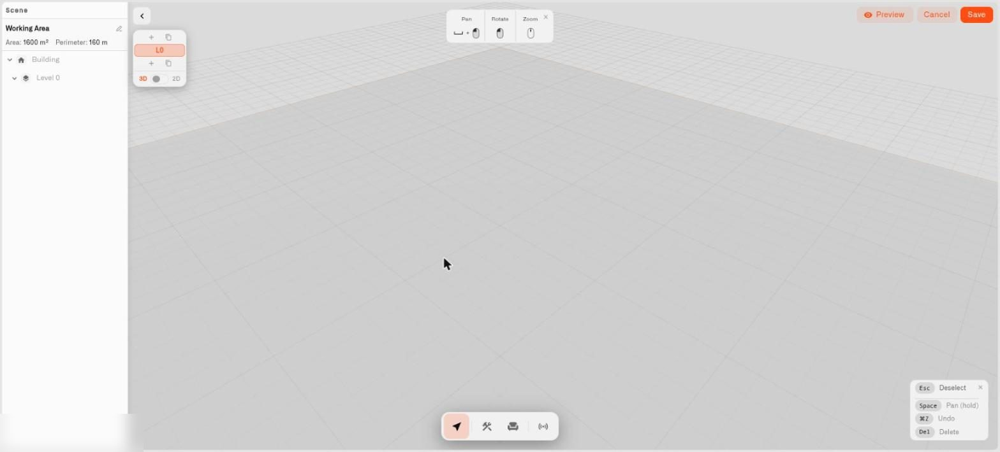

# Editor Tour

The Digital Building Twin editor is a full-screen workspace where everything happens — drawing rooms, adding furniture, connecting sensors, setting up the view. This page is a quick walk around it so the rest of the section makes sense. Think of it as the welcome tour; the other pages are the detailed how-tos.

When you add a **Digital building twin** widget, the editor opens with a small starter model already there — a building with one floor. You grow it from there.

<figure><figcaption>
A new Digital Building Twin editor with its starter building.
</figcaption></figure>

## The bottom toolbar

The toolbar in the middle of the bottom edge is your main control. It has four modes:

* **Select** — the normal mode. Click things to pick them up, move them, and change their settings. Press **Escape** any time to come back here.
* **Build** — opens the building tools: **Wall**, **Door**, **Window**, **Fence**, and **Trace from map**. This is how you draw the shell of your home. See [Drawing your home](drawing-your-building.md).
* **Furnish** — opens the object library: five tabs (**Furniture**, **Appliance**, **Kitchen**, **Bathroom**, **Outdoor**) and a strip of 3D models to drop in. See [Placing objects](placing-objects.md).
* **Sensors** — opens the Sensors panel, where you connect your devices and link their readings to things in the model. See [Connecting sensors and colors](binding-sensors-and-colors.md).

Click a mode to switch into it; click it again to go back to Select.

## The Scene panel

The **Scene** panel is a list of everything in your model, shown as a tree — your building, each floor, and the walls, items, doors, and windows on it. Click anything in the list to select it in the view. Double-click it (or use the little pencil) to rename it. Renaming is worth doing: "Kitchen wall" or "Front door" is much easier to find later than "Wall 9."

## The settings panel

Click any object and a panel opens with that object's settings:

* **Furniture and objects** — Name, Position, Rotation (with handy **+45°** / **-45°** buttons), Scale, and size.
* **Walls** — Length, Height, Thickness, and a **Material** you can pick: white, brick, concrete, wood, glass, metal, plaster, tile, marble, or your own color.
* **Doors and windows** — Width, Height, where they sit along the wall, which side a door is hinged, which way it swings.

Whatever you've selected also gets a little badge with quick **Move**, **Duplicate**, and **Delete** buttons. It shows up in the flat **2D view** too, so you can rearrange a whole room from the plan without tilting back to 3D, and the settings panel offers **Duplicate** for doors, windows, and furniture alike.

## Moving around the model

There are two ways to look at your model:

* **3D view** — spin around it freely. Drag with the left mouse button to rotate, the right button to slide the view across, and the scroll wheel to zoom in and out. Hold the **Space** bar to make left-drag slide instead of rotate.
* **2D view** — a straight-down, flat floor-plan view. You can't rotate it — just slide and zoom. It's the easier view for laying rooms out neatly.

The view you leave the editor in is saved with the widget and is what the dashboard tile shows, so set it the way you like before saving. Flipping between **Edit** and **Preview**, or from 3D to 2D and back, keeps the angle you had, and the little nudge you gave the view with the arrow buttons is remembered as well. Save while you're in 2D and the tile still keeps your 3D angle for the next time. The dashboard shows the view exactly as you framed it, not re-centered on the house.

## The floor buttons

A little floating stack of floor buttons sits off to one side. It lists each floor (**L0**, **L1**, and so on), lets you add a floor above or below, and switches which floor you're working on. It also holds the **3D / 2D** switch and, if your home has more than one floor, a **Stack / Solo** switch. See [Floors and levels](floors-and-levels.md).

## Undo, redo, and removing things

* **Undo** — Ctrl+Z (Cmd+Z on a Mac).
* **Redo** — Ctrl+Shift+Z (Cmd+Shift+Z).
* **Remove something** — select it and press **Delete** or **Backspace**, or use the Delete button on the badge or settings panel. Your building and its floors are protected, so you can't delete those by accident.
* **Back out of a tool** — press **Escape** or right-click to drop whatever tool you're using and return to Select.

## Saving and closing

* **Save** — the button in the top-right corner. It asks for a **Widget name**; type or confirm it and your model is saved onto the dashboard.
* **Cancel** — closes the editor. If you have unsaved changes it checks first with a **Discard unsaved changes?** message — choose **Discard** to leave or **Keep editing** to stay.

## See also

* [Drawing your home](drawing-your-building.md) — Walls, doors, and windows
* [Floors and levels](floors-and-levels.md) — Multiple floors and the 2D/3D switch
* [Placing objects](placing-objects.md) — The object library
