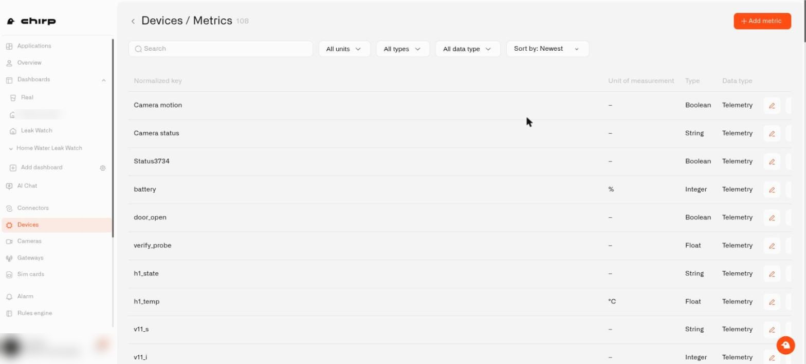
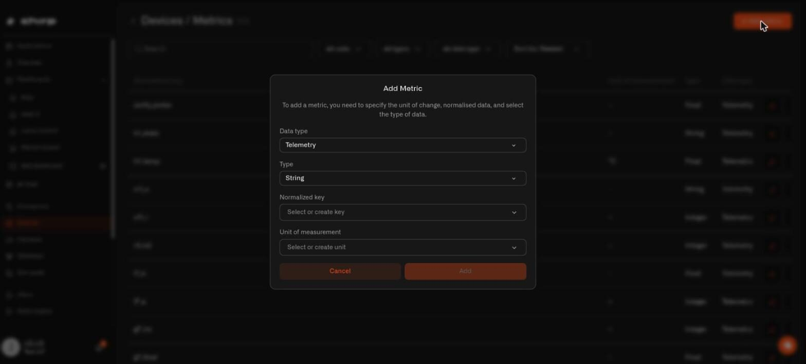
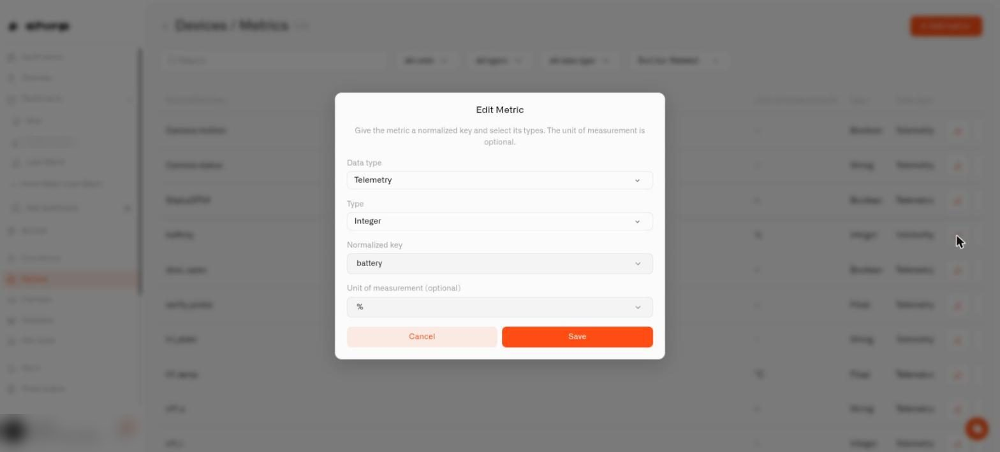

# Data Templates

A data template tells Chirp what a sensor reading means and how to display it. In the interface, these definitions are called **metrics**.

A metric carries two type settings, and they are not the same thing. **Data type** is about the kind of information (telemetry, device metadata or a custom attribute), while **Type** is about the shape of the stored value: Float, Integer, String or Boolean.

For example, one temperature sensor may send `temp_c` while another sends `t`. Mapping both raw names to a metric called `temperature` lets your dashboards and automations use them in the same way.

Most common sensors already have the metrics they need. Use this page when adding an unusual sensor, correcting a reading, or creating a measurement that does not exist yet.

## Open your metrics

Go to **Devices → Metrics**.

The list shows every metric available in your current organization, including its normalized key, unit, value type, and data type.

<figure><figcaption>
The Metrics list.
</figcaption></figure>

Use the controls above the list to find a metric:

- **Search** matches the normalized key, which is the standard name of the reading.
- **All units** filters by unit and includes readings without a unit. Select the units and click **Apply**.
- **All types** narrows the list to String, Integer, Float or Boolean metrics, and the list updates as soon as you choose.
- **All data type** narrows the list to Telemetry, Device metadata or Custom attributes, again updating at once.
- **Sort by** orders metrics by **Newest** or **Oldest**.

The unit, type, and data-type filters accept several values at once.

Metrics you created provide **Edit** and **Delete** actions. Metrics supplied by Chirp do not, because they are shared definitions used by standard sensor setups.

## Add a metric

1. Go to **Devices → Metrics**.
2. Click **Add metric**.
3. Complete the four fields in the **Add Metric** dialog.
4. Click **Add**.

<figure><figcaption></figcaption></figure>

### Data type

Choose what kind of information the metric represents:

| Data type | Use it for | Home examples |
|---|---|---|
| **Telemetry** | Readings that change over time | Temperature, humidity, battery level |
| **Device metadata** | Information the sensor reports about itself | Firmware version, hardware revision |
| **Custom attributes** | Information you add | Room name, installation date, next battery change |

Use **Telemetry** for the readings you want in history, dashboards, and automations. The catalog also lists Device metadata and Custom attributes, but these categories cannot be selected for incoming telemetry. Creating such a template does not provide a working screen for storing your own notes or room assignments.

### Type

Choose how Chirp stores the value:

| Type | Use it for | Examples |
|---|---|---|
| **Float** | Numbers with decimals | `22.5`, `67.3` |
| **Integer** | Whole numbers | `85`, `-120` |
| **String** | Text | `"open"`, `"standby"` |
| **Boolean** | True or false | Motion detected, door closed |

Incoming values are converted to the chosen type; incompatible values are skipped. See [What Your Device Is Sending](what-your-device-is-sending.md#readings-keep-the-shape-they-arrived-in) for the conversion rules.

Only Integer or Float metrics can feed chart widgets and the gauge-style Last Data displays. The Last Data **Value** display is more flexible and can also show text and yes/no values.

### Normalized key

The normalized key is Chirp's standard name for the reading, regardless of the raw name used by the sensor.

In the **Normalized key** field, pick a key that already exists or choose **Create a new normalized key**. Give it a clear name such as `soil_moisture`, not a sensor-specific name such as `sensor_3_value`. Use lowercase words separated by underscores.

Each normalized key can belong to only one metric. If it is already in use, the form reports **A metric with this normalized key already exists**.

Normalized keys are created, renamed, and deleted from this field. Keys supplied by Chirp cannot be renamed or removed.

### Unit of measurement

The unit is the symbol shown next to the value, for instance °C, %, lx or mV. Pick one from the list, or choose **Create a new unit** and type the symbol exactly the way it should be displayed.

You never have to give a unit. A door is open or closed and a mode is just a word, so leave the field empty for those; add a unit like °C or % when it makes the number easier to read.

Units are created, renamed, and deleted from this field. Units supplied by Chirp cannot be renamed or removed.

## Edit a metric

Metrics apply across the current organization, not to one sensor only. Editing a metric changes the definition for every sensor mapped to it.

1. Find the metric under **Devices → Metrics**.
2. Select the pencil icon at the end of the row.
3. Update the required fields.
4. Click **Save**.
5. Review the confirmation describing which sensors are affected and confirm the change.

<figure><figcaption>
The Edit Metric dialog. The unit is optional.
</figcaption></figure>

The one thing you can't switch while a sensor uses the metric is its **Data type**. If you try, the window stays open and tells you: *This metric is attached to devices. Detach it from all of them to change its data type.* Take the metric off those sensors first, or make a new metric for the new type. Editing never wipes the description you wrote.

If only one sensor needs a different definition, create a separate metric. Changing a row to that template replaces its measurement assignment, so use this for a new kind of reading rather than a hardware replacement that should keep the old history.

## Delete a metric

Click **Delete** on a metric you created and confirm the action.

Chirp refuses to delete a metric that is still mapped to a sensor. Remove the mapping from every sensor that uses it, then try again.

## Connect a sensor reading to the metric

Creating a metric does not connect it to a sensor automatically. Open the sensor's **Mapping** tab and map the raw key sent by the sensor to the normalized metric.

Once different sensors map their temperature readings to `temperature`, the same chart or automation can work with all of them.

## Keep familiar readings when hardware changes

A data template gives a reading its meaning. The measurement attached to **Family Car** is the car's own record of that kind of reading. Another car can use the same template without sharing its history.

After replacing a tracker, keep the existing latitude, longitude, and speed rows. In **Mapping**, connect the new tracker's fields to those rows instead of removing and recreating them. Their saved readings then remain attached to the same car.

Check the units too. Giving a speed value a km/h label does not convert a value reported in another unit. The source or decoding step must provide the expected value. Follow [Replace your car's tracker](sensor-details.md#replace-your-cars-tracker) for the complete sequence.

## Troubleshooting

| Problem | What to check |
|---|---|
| A metric is missing from a chart or gauge-style Last Data display | Confirm its **Type** is Integer or Float and the sensor sends a numeric value. |
| A metric is missing from a sensor mapping | Confirm its **Data type** is Telemetry. |
| A normalized key is greyed out or refused | A different metric probably owns that key already. Search the list to find it. |
| The data type won't change | A sensor still uses the metric. Detach it from every sensor, or create a new metric. |
| Edit and Delete are unavailable | The metric, key, or unit was supplied by Chirp and cannot be changed. |
| Delete is refused | Remove the metric from every sensor mapping before deleting it. |

## See also

- [Adding Sensors](adding-sensors.md) — map readings while adding a sensor
- [What Your Device Is Sending](what-your-device-is-sending.md) — identify raw keys in incoming data
- [Sensor Details](sensor-details.md) — change mappings on an existing sensor
