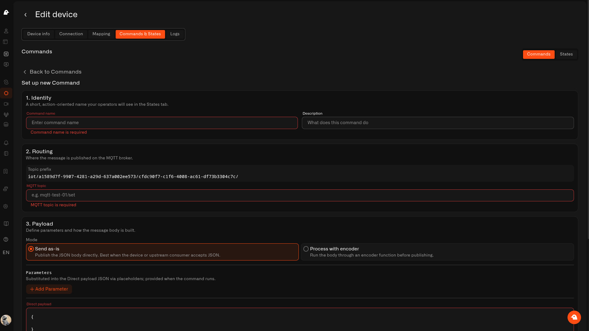

# MQTT Devices

An **MQTT device** gets its readings into Chirp by publishing messages to an MQTT broker. The publisher may be equipment with a built-in MQTT client, or a sensor that reaches the broker through a bridge. Three things work together: the broker connection moves the messages, the device's routing settings tie each message to a **digital twin**, and the mapping converts message fields into stored measurements.

A Zigbee temperature sensor is a good example: it can report through Zigbee2MQTT to a twin called **Living Room Climate**. If you swap the sensor later, the room's measurements stay together in Chirp.

## Before you start

- Set up a [Cloud MQTT](../connectors/mqtt/cloud-mqtt.md) connection if Chirp supplies the broker, or [External MQTT](../connectors/mqtt/external-mqtt.md) if your equipment already publishes to a broker elsewhere. Broker addresses, credentials and connectivity are covered in those guides.
- Keep the publisher's exact topic and a sample payload at hand, and make the hardware or bridge publish before you finish measurement mapping.
- Your account needs permission to create and edit devices, and your plan must have room for one more twin. With read-only access you can view the settings but not change them.

If the hardware is Zigbee, begin with [Setting up Zigbee2MQTT](../connectors/mqtt/zigbee2mqtt.md). Chirp only sees the MQTT messages from the bridge; the sensor itself keeps speaking Zigbee. Pairing and installing the bridge are handled in that guide.

## Connect one device

1. Go to **Devices → Add device**, or press **Add device** on your MQTT connector's row.
2. Type a **Device name** such as **Living Room Climate**, add photos if you want, and click **Save**. The [shared registration steps](adding-sensors.md) explain profile and Application settings.
3. On **Connection**, choose your MQTT connection in **Connector type**. For this example, set **Device ID** to `LivingRoomSensor`.
4. Under **MQTT Topic for device ID**, add a **Text segment** with the text `zigbee2mqtt`, followed by a **Device ID** segment. **Where to get the device ID** stays on **Topic**. The resulting device-level pattern is `zigbee2mqtt/{{deviceId}}`.
5. Check **Resolved preview** against the topic the publisher really uses. With Cloud MQTT the preview shows the connector's locked prefix, and the publisher has to publish with that same prefix. With External MQTT, take the publisher's complete topic as it is and leave out any Cloud prefix.
6. For the JSON example below, **Topic Telemetry** stays empty. Enter the cadence you expect in **Data sending interval** and click **Save**.
7. Have the publisher send a new message, then open **Mapping** and choose the templates and received keys for the measurements you want. Save, and let one more message come in.
8. Open **Logs**, pick a date range that includes that message, and check that the mapped measurements have recorded values.

### Example topic and payload

| Setting | Example |
| --- | --- |
| Digital device name | `Living Room Climate` |
| Device ID | `LivingRoomSensor` |
| Device-level topic | `zigbee2mqtt/LivingRoomSensor` |
| Cloud publishing topic | `{Topic prefix}/zigbee2mqtt/LivingRoomSensor` — substitute the prefix supplied by your connector |
| External publishing topic | `zigbee2mqtt/LivingRoomSensor` |

```json
{"temperature": 21.4, "humidity": 58, "battery": 92}
```

Assign `temperature` to a Float template in °C, `humidity` to a numeric humidity template in %, and `battery` to a numeric battery template in %, provided that is what the sensor actually outputs. Look at the fields your device exposes instead of assuming every sensor publishes these keys.

## Connection fields and actions

| Control | How to configure it |
| --- | --- |
| **Connector type** | Choose the Cloud or External MQTT connection that receives this publisher's messages. If the connection you need is missing, **Connector section** takes you to its setup. |
| **Device ID** | Required. Anything from 1 to 64 characters is fine, as long as each one is an ASCII letter, a digit, a space, a period, an underscore or a hyphen. MQTT identifiers keep their case and spaces, so the value must be identical to the topic segment or payload identifier it is compared with; `Sensor1` and `sensor1` are two different IDs. After binding, the identity is locked. A name without spaces is easier to work with, but Chirp never strips spaces for you. |
| **MQTT Topic for device ID** | Compose the topic pattern for the messages this device should receive. The Cloud prefix is shown read-only and is already included, so do not type it again as a text segment. |
| **Where to get the device ID** | **Topic** takes the ID from the Device ID segment. **Payload** takes it from a field in the message body; in that case fill in the **Payload template** and drop the Device ID segment from the device topic pattern. |
| **Payload template / Payload preview** | In Payload mode, write a dot-separated path such as `deviceInfo.deviceId`. The preview only sketches the JSON shape you expect; nothing is published and no message is validated. |
| **Topic Telemetry** | Optional rows for values that travel inside topic segments. Ordinary JSON payloads need none. The [routing reference](../connectors/mqtt/topics-and-device-routing.md#topic-telemetry) describes every row control, including **Apply all**. |
| **Data sending interval** | A positive whole number plus **minute**, **hour**, **day**, **week** or **month**, starting at **1 hour**. Enter the cadence your publisher is expected to follow; the publisher's own schedule is not touched. Sensors that only report on events may have a heartbeat, which is worth remembering when you read missing-data diagnostics. |
| **Detach physical device** | Drops the saved binding right away. Use it to swap a publisher on the same twin, then set the routing up again and connect the new incoming fields to the existing measurements. |
| **Save** | Stores the device connection, the routing and the key assignments. If an error appears, read it before assuming new messages already follow the edited setup. **Apply all** and topic previews do not save anything. |

The [Topics and Device Routing](../connectors/mqtt/topics-and-device-routing.md) reference covers editing segments, validation, nested payloads, values pulled from topics and arrival timestamps.

## Map messages to retained measurements

**Mapping** pairs the keys that have arrived with the templates you assign. Click **Add key**, pick the **Normalized key**, then pick a **Device data key**. The dropdown of keys is filled from messages Chirp has received, so it can be empty until the device publishes after its connection was saved.

Feel free to save the connection first and come back to mapping when keys have arrived. Template rows you already added can stay; finish assigning their keys. The **Value** and **Last update** columns display snapshots of received fields, which is not proof that history is being stored. If a row's data key is left blank, that measurement records nothing. Save the mappings, then wait for a new message to be published, because messages from before are not backfilled.

The mapping's **Data type** is **Telemetry**, which also covers reported switch states you want recorded. How a value is interpreted depends on the template's **Type**: `"ON"` and `"OFF"` need String, whereas real `true` and `false` can use Boolean. A value that does not fit the type is rejected for that measurement; it is not stored as an empty reading.

[Mapping controls](sensor-details.md#metrics) explain Unit, Type, creating a metric inline, removing a row and what changes when you replace a template. Come back to mapping whenever the firmware starts publishing additional fields worth keeping.

## Commands and replacing hardware

Once an MQTT binding is saved, the device can offer **Commands & States**. The hardware has to subscribe to the command topic you configure and understand the command payload; the fact that it sends telemetry says nothing about that. [Creating Commands](commands/creating-commands.md) covers topic addressing, JSON parameters, encoders and feedback verification.

When the hardware changes, **Living Room Climate** and its measurements stay. Follow [device replacement](sensor-details.md): update the physical Device ID and the routing, then reconnect the new keys, and review command topics and expected feedback as well. Whatever was already retained under those measurement identities remains attached to the twin for as long as the retention period allows.

<figure><figcaption><p>For hardware that accepts commands, configure the outbound topic separately from incoming telemetry routing.</p></figcaption></figure>

## If setup does not work

| Symptom | Next check |
| --- | --- |
| The connection will not save | A non-empty topic, a matching identifier mode and path, a valid Device ID, the required fields of telemetry rows, your permissions, and identifiers that may already be taken. |
| The broker gets messages, but no device keys show up | Compare the resolved topic, Cloud prefix, spelling of the identifier and payload path against a real message. |
| Keys show up, yet Logs is empty | Look at the saved mapping, whether types fit, whether a new message came in, and which history range is selected. |
| Only part of the readings are missing | Read the real payload fields and any normalization errors; fields inside nested JSON use dot-separated names. |
| Old buffered readings appear with a recent time | MQTT measurements are stamped on arrival. A `timestamp` field in the payload is just data and cannot move history to an earlier date. |

See [MQTT Troubleshooting](../connectors/mqtt/troubleshooting.md) and [device diagnostics](connection-diagnostics.md).
