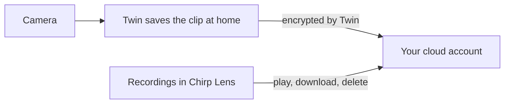

# Back Up Home Camera Recordings to the Cloud

Imagine the computer running Twin sits in a hallway cupboard, and someone walks off with it, or its disk simply gives up. The clip you wanted goes with it. Cloud backup puts a second copy of each recording in an account you own, so the evidence survives the hardware.

It adds to local recording and never replaces it unless you choose to. Twin saves each clip at home first, then uploads a copy to the cloud account you pick.

## Who benefits most from cloud backup?

- **Holiday homes and rental units** you only visit now and then, where you want to review footage from afar.
- **Homes where Twin runs on a spare laptop or mini PC.** A copy elsewhere means that machine is no longer your only safe place.
- **People who want ownership.** The cloud account, the bill, and the retention choices are yours.

## What happens to a clip on its way to the cloud?

1. Twin records a clip, following your [local recording](local-recordings.md) settings.
2. Twin encrypts the clip before it leaves your network, so nothing travels or sits in the account unencrypted.
3. The upload goes straight from Twin to your account without passing through Chirp's servers. Chirp then verifies that the clip arrived whole.
4. The clip appears on the **Recordings** screen, and Chirp can play it back.

Thumbnails, screenshots, and exports that Lens builds from a clip stay with Chirp, not in your bucket.

## Is a backed-up clip private?

The plain answer is on the connector form itself: **Your storage keeps the recordings; the platform keeps the keys and previews and can read the archive.** The files are encrypted in transit and at rest, and Chirp holds the keys because it must decrypt a clip to show it to you. That keeps clips away from outsiders, but it is not end-to-end encryption and it does not hide footage from the platform. Rotating a key protects clips recorded afterward, not older ones.

## How do I switch on cloud backup?

Your camera's Twin must run version **1.1.0** or later; an older Twin keeps recording locally and says it cannot upload. [Installing Twin](installing-twin.md) covers updating. You also need **Edit** access to cameras, since the Recordings, Cameras, Videowalls, and Storage screens all require it, and a View-only role is turned away.

1. In Lens, open **Storage** at the bottom of the sidebar.
2. Select **Add storage connector** and complete the form for your provider. [Storage Connectors](storage-connectors.md) explains every field.
3. Go to **Cameras**, open your camera, and select the **Storage** tab. Scroll to the **Cloud backup** card, whose subtitle says the Twin keeps recording locally and also uploads a copy.
4. Open the **Backup to** list and choose your connector. The first entry, **None (local only)**, turns the feature off. If the list is empty, the card says no connectors are configured and offers **Manage storage connectors**.
5. Once a connector is selected, more controls appear:
   - **Upload queue folder**: an advanced path for clips waiting to upload; leave it empty for the default.
   - **Delete local clips after upload**: removes the home copy after Lens confirms the upload. Leave it off to keep a permanent local backup too.
   - **Limit cloud storage**: when on, a **Maximum cloud storage (MB)** field appears, and the oldest cloud backups are deleted once the camera passes that size. Local clips are unaffected.
6. Select **Save** at the bottom, then **Send to camera** so Twin receives the new settings.
7. Trigger some motion and watch for the new clip in **Recordings**.

Higher up the same tab, **Automatic cleanup** has **Limit by total size** and **Limit by age**. The age limit, **Maximum recording age (days)**, applies to cloud backups as well as local clips, and the card shows "Kept for at least N days", so a short limit will also remove cloud copies.

## How do I find, save, or delete a clip?

Choose **Recordings** in the Lens sidebar. The toolbar has an **All devices** drop-down, a **Date range** button, a sort drop-down (**Newest first** or **Oldest first**), and the buttons **Export**, **Clear filters**, and **Refresh**. Use **Refresh** to pull in new clips.

- **Play** a clip in Chirp's player. If your storage cannot serve partial reads, a notice says seeking is unavailable; with Walrus, pick an aggregator that supports range requests.
- **Download** it to your phone or computer, or use **Export** to prepare a ZIP package of selected clips.
- **Delete recording** appears for Amazon S3 and Google Cloud Storage and removes the file from your bucket permanently.
- **Remove from archive** appears for Walrus clips, for clips whose storage period has ended, and for clips whose key was erased. The clip leaves your list, but the file remains in your storage until its paid period ends or you delete it there yourself.

## What do the clip states mean?

- **Unreadable:** the clip was damaged during upload and cannot be played. It still takes up space in your storage.
- **Storage period ended:** Walrus kept the clip for the period you paid for, and it is no longer available.
- **Archive disconnected — key erased:** you disconnected the storage, so Chirp can no longer decrypt its clips.

## How do I stop using a storage account?

On the **Storage** screen, choose **Disconnect storage** for that connector and type its name to confirm. Chirp permanently erases its keys. Your files stay in the account, but Chirp can no longer open them. A separate action marks a key as compromised and issues a fresh one for future clips.

## Which provider should I choose?

| Your situation | Choose |
|---|---|
| You already have a cloud provider, or a service that follows the S3 convention | **Amazon S3** |
| You have Google Cloud with a bucket | **Google Cloud Storage**, which is newly released: record one short clip and play it back before relying on it |
| You like paying for a fixed storage period on a decentralized network | **Walrus** |

Continue with [Storage Connectors](storage-connectors.md) for the forms.
