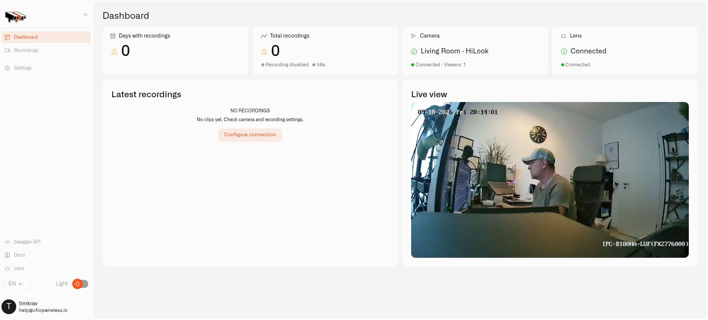

# How to Connect a Camera to Chirp Lens
Before a camera appears in Chirp, its Twin needs to reach the camera and pair with Lens. Work through the local connection first so that you can distinguish a camera problem from a cloud connection problem.

Have [Twin running](installing-twin.md), your camera's connection details ready, and permission to manage cameras in the selected Chirp organization.

Need the video address? [RTSP Camera URLs](rtsp-camera-urls.md) gives common patterns, including the Tapo and HiLook cameras used in our examples.

## How does Twin reach my camera?
1. Sign in to Twin and open **Settings → Camera Connector**.
2. Put your camera's RTSP address in **Main stream URL**, with the camera's local login included. Use **Test main stream** to check the connection.
3. For a lighter preview and motion-detection feed, put the camera's substream address in **Low-resolution stream URL**. You can leave it empty to use the main picture for both.
4. Select **Save** and check the picture on Twin's dashboard.

For a compatible motorized camera, also fill in **ONVIF address**, **ONVIF username**, and **ONVIF password**. Use **Test ONVIF** and the **Save** button in that section. The **Scan** button under **Discover ONVIF cameras** helps locate supported cameras nearby. ONVIF provides camera controls such as movement and presets; the RTSP address provides video.

Give the camera a recognizable name such as `Front door`.

Copy the **Twin Key** from Twin. This identifies this camera's local installation; each of your other cameras must have its own Twin and key.

## How do I add a camera to Chirp?
1. Select **Cameras** in the Chirp sidebar, then **Cameras** in the Lens sidebar.
2. Choose **Add camera**. The dialog reminds you to set up the Twin first, because it generates the key and a camera cannot be added ahead of its Twin.
3. Enter the **Camera name** and paste the key into **Twin Key** (placeholder "Paste the key from the Twin"). Extra spaces around the key are trimmed. **Add camera** stays disabled until both fields are filled.
4. Select **Add camera**. The dialog changes to **Pairing token** and says the camera is registered. It shows the **Lens API URL** and the **Connection token**, each with a copy button; the token has a reveal/hide eye icon and an expiry time ("Expires ..."). The token is shown only once and cannot be retrieved later.
5. Copy the token (the **Done** button stays disabled until you have tried copying it; if copying is unavailable in your browser, select the token and copy it by hand), then select **Done**. If the dialog says the Lens API URL is not configured, select **Retry**; the button reads **Close** instead of **Done** in that case.
6. Return to Twin and open **Settings → Lens Connector**. Paste the **Lens API URL** and the **Connection token** and save. Twin pulls the rest of its configuration from Lens.

If adding fails, the dialog tells you why:

| Message | What to do |
|---|---|
| "This Twin Key is already registered", plus a hint to generate a new key in the Twin when the image was cloned. | The key belongs to a camera already in Chirp. A cloned Twin image needs a fresh key first. |
| You do not have permission to add cameras in this organization. | Ask an organization admin for **Edit** access to Cameras. |
| Your subscription plan has no room for another device. Remove one or upgrade the plan. | Remove a device you no longer use, or change the plan. |
| The video service is unavailable, so the camera was not created. Try again in a moment. | Wait a minute and add the camera again. |
| The camera could not be added. Try again. | Retry; if it repeats, check the Twin Key for typos. |

The token is a private pairing credential. It is different from your camera password and from the password you use to sign in to Twin. Use the Lens API endpoint for the same environment that issued the token.

<figure><figcaption>
Each camera has its own Twin dashboard and connection state.
</figcaption></figure>

## How do I check the connection and video?
Back in Chirp, wait for the camera's state to become online, then start its live video. Seeing the picture confirms that the camera, Twin, Lens, and browser can complete the viewing path.

For a second camera, repeat the process with its separate Twin. If you need to pair an existing camera again, open its details and choose **Reconnect Twin** rather than adding a duplicate. [Access and Troubleshooting](access-and-troubleshooting.md) covers that recovery.
