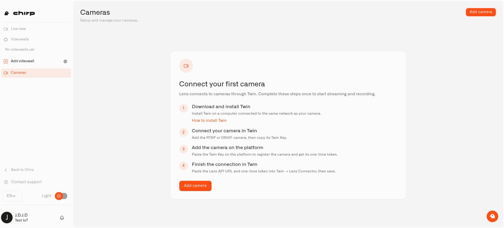
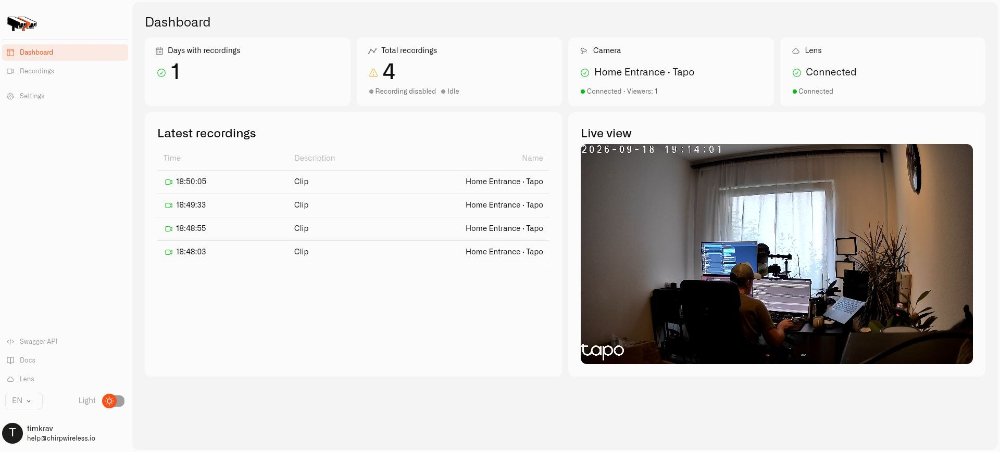

# How to Install Chirp Lens Twin
Twin is the part of your camera setup that runs at home. It connects one camera to Chirp Lens in the cloud, so the computer running it needs to stay on whenever you want that connection available.

Use one Docker container per camera. For a front-door and garden camera, make two Twins with separate names, ports, and saved settings.

<figure><figcaption><p>Lens guides you from a local Twin installation to a connected camera.</p></figcaption></figure>

<figure><figcaption><p>After setup, Twin shows its local camera picture and connection to Lens.</p></figcaption></figure>

## What do I need to install Twin?
- An amd64 or arm64 computer running Docker Engine on Linux, or Docker Desktop with Linux containers on Windows or macOS.
- Local network access from that computer to the camera.
- The camera's RTSP stream address and credentials.
- Internet access for the connection to Lens.
- Persistent disk space if you want to save recordings.

Get the official image from [chirpiot/lens-twin on Docker Hub](https://hub.docker.com/r/chirpiot/lens-twin). Choose a host with enough processing and network capacity for the number and quality of streams you intend to use.

### How do I check Docker is ready?
Install [Docker](https://docs.docker.com/get-started/get-docker/) if it is not already on the computer. On Windows or macOS, open Docker Desktop, use Linux containers, and wait for its engine to finish starting. On Linux, make sure Docker Engine is running; follow Docker's [engine startup instructions](https://docs.docker.com/engine/daemon/start/) for your installation.

In the terminal you will use to start Twin, run:

```sh
docker info
```

Continue when you see server information without a connection or permission error. `docker --version` only checks the installed command-line tool: it can print a version even when Docker's engine is stopped. If the readiness check fails, use [Access and Troubleshooting](access-and-troubleshooting.md#what-are-common-chirp-lens-problems) before running Twin.

Keep Docker running and the computer awake while you need your cameras. Quitting Docker Desktop or letting the computer sleep disconnects its Twins.

## How do I run Twin for my first camera?
On the Docker computer, this Bash example creates persistent Docker volumes for a front-door camera and asks for a **temporary Twin setup password**. Choose a unique password and keep it until you finish the first-login steps below. Windows users should use the [PowerShell example](#how-do-i-install-twin-on-windows-and-macos).

```bash
read -rsp 'Temporary Twin setup password: ' TWIN_PASSWORD
printf '\n'
export TWIN_PASSWORD
docker run -d --name front-door-twin --restart unless-stopped \
  -p 127.0.0.1:8080:80 \
  -e TWIN_USERNAME=admin -e TWIN_PASSWORD \
  -v front-door-config:/home/twin/data/config \
  -v front-door-recordings:/home/twin/data/recordings \
  chirpiot/lens-twin:1.0.1
unset TWIN_PASSWORD
```

> **Cloud backup needs Twin 1.1.0 or later.** The `1.0.1` image in these commands covers live video and local recordings but cannot back clips up to cloud storage. When you want cloud backup, upgrade by changing only the image tag, as described in [How do I restart or upgrade Twin?](#how-do-i-restart-or-upgrade-twin), and keep your volumes.

Visit `http://127.0.0.1:8080` on the same computer to complete the first login below. A fresh Twin will not start without its required login setup.

This example keeps the administration port local to the computer. If you administer a separate home server, use your secure remote-access method to reach that port rather than exposing it to the internet.

### Which password do I use?

Twin does not ship with a default production password. The command above sets the username to `admin` through `TWIN_USERNAME` and uses the temporary password you typed as `TWIN_PASSWORD`. You can keep the username `admin`.

If you are following the command shown inside Lens instead, replace `CHANGE-ME` with your own unique temporary password before running it. Do not leave the placeholder as your password. That command includes the password in its text, so it remains visible in shell history and container settings; use one you do not use elsewhere.

There are two stages: the temporary password protects access to a new Twin, then the browser asks you to set the password you will keep using. Complete setup in **Twin's local interface**:

1. Sign in as `admin` with the temporary password from the command or prompt.
2. On **Set your credentials**, enter that same temporary password in **Current password**.
3. Enter your permanent password in **New password** and repeat it in **Confirm new password**.
4. Leave **New username (optional)** empty to keep `admin`, or enter your preferred username.
5. Select **Save and continue**.
6. Sign in again using your permanent password and the username you kept or chose.

Your camera's password and your Chirp account password are separate from these Twin credentials.

If another person installed Twin, ask them for its initial login. There is no universal factory password; use the one supplied when your Twin was installed.

Choose at least eight non-space characters, including uppercase and lowercase letters, a number, and a symbol. To change the local login later, open your user menu and choose **Change password**. After you change the password, use the new one for future visits. The initial environment variables do not replace credentials already saved in the configuration volume.

## How do I keep each Twin separate?
For a garden camera, use a different container name, another host port such as `8081`, and new `garden-config` and `garden-recordings` volumes. Do not copy the first camera's populated configuration: Twin creates a unique **Twin Key** for each installation.

Keep those volumes when restarting or replacing the same container. They preserve its identity, camera settings, and any saved clips. New installations do not record automatically.

Next, [connect the camera and pair Twin with Chirp](connecting-a-camera.md).

## How do I install Twin on Windows and macOS?
Complete [Check Docker is ready](#how-do-i-check-docker-is-ready) first. On macOS, use the Bash example above. On Windows, this PowerShell equivalent asks for the same kind of temporary setup password:

```powershell
$twinInitialSecret = Read-Host 'Temporary Twin setup password' -AsSecureString
$env:TWIN_PASSWORD = [System.Net.NetworkCredential]::new('', $twinInitialSecret).Password
docker run -d --name front-door-twin --restart unless-stopped `
  -p 127.0.0.1:8080:80 `
  -e TWIN_USERNAME=admin -e TWIN_PASSWORD `
  -v front-door-config:/home/twin/data/config `
  -v front-door-recordings:/home/twin/data/recordings `
  chirpiot/lens-twin:1.0.1
Remove-Item Env:TWIN_PASSWORD
```

Visit the local Twin address and follow [Which password do I use?](#which-password-do-i-use) to finish setup. Docker also needs access to the camera's local IP address. If Docker Desktop cannot discover the camera automatically, supply its address or RTSP URL yourself.

## How do I restart or upgrade Twin?
For a normal restart, run `docker restart front-door-twin`. For an image upgrade:

1. Before you start, copy the Twin's persistent configuration, along with any recordings you want to keep.
2. Find the version you want in the official Docker Hub repository and pull it: `docker pull chirpiot/lens-twin:<version>`.
3. Stop and remove only the old container with `docker stop front-door-twin` and `docker rm front-door-twin`.
4. Repeat the installation command, changing only the image tag; keep the **same** volume names for configuration and recordings, the same port and every other option.
5. Log in with the local credentials you saved, then check that local video plays and the Lens connection is up.

Do not remove the volumes during an upgrade. The camera feed drops for a moment while the container is replaced, but the kept configuration preserves the camera's identity and pairing.
