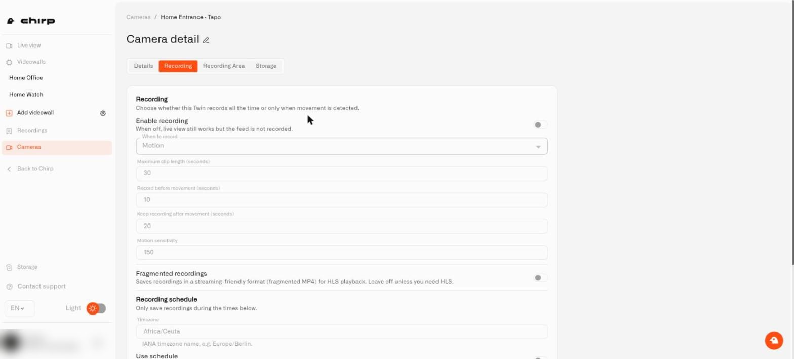
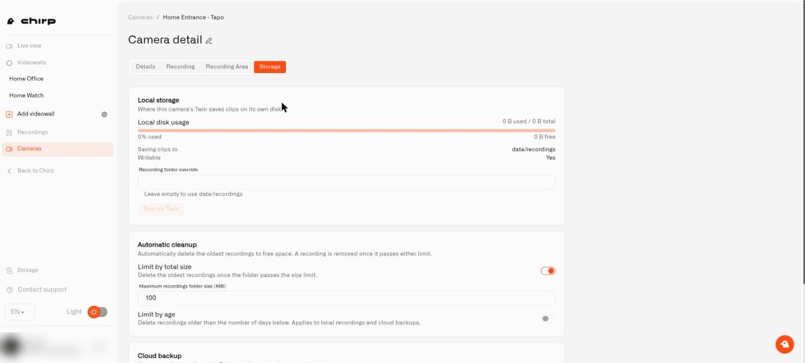
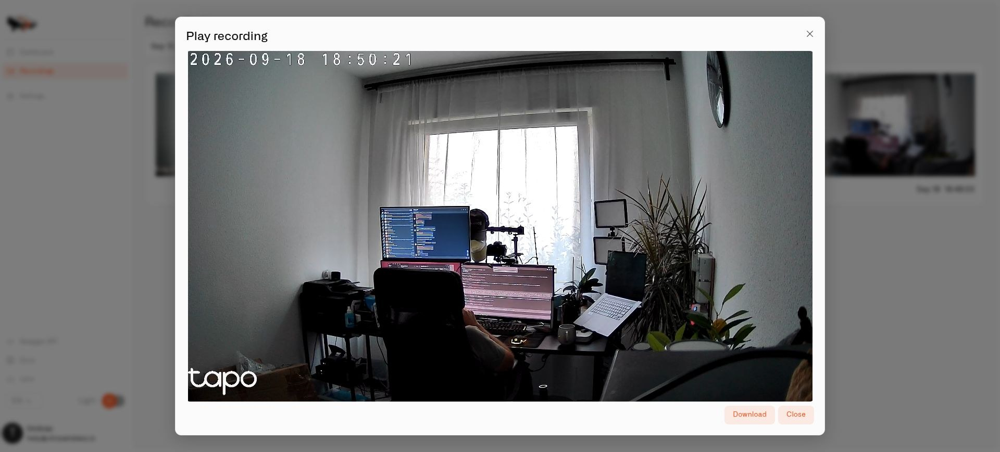

# Local Recordings

Twin can keep camera recordings on the computer at your home. This lets you review a clip after an event instead of needing to watch live at the time. Saving video is off when you first install Twin.

The controls and saved clips in this guide are in **Twin's local interface**. Make sure the recording folder uses persistent storage before you turn recording on.

## Choose what to save

Open **Settings → Recording**, enable recording, and choose **Motion** or continuous recording under **When to record**. Save the settings.

Motion mode records around detected activity. Configure the pre-recording and post-recording periods to include context before and after movement, and use the maximum clip length to control how recordings are divided. [Motion Zones](motion-zones.md) helps you focus detection on a doorway or gate.

Continuous mode saves video without waiting for movement and skips motion processing. Choose **Motion** for camera-motion rules. You can leave recording disabled if you want motion readings without saving clips.

### Clip timing and sensitivity

| Setting | Effect |
|---|---|
| Maximum clip length (seconds) | Caps the length of a saved clip. Continued movement can result in further clips. |
| Record before movement (seconds) | Includes buffered video from before the trigger. The amount available depends on the camera's keyframes and buffer. |
| Keep recording after movement (seconds) | Adds context after the trigger; further movement can extend the clip up to its maximum length. |
| Motion sensitivity | Threshold measured in changed pixels. Lower values detect smaller changes; a value around 150 is the balanced default. |

### Set a recording schedule

Twin's supplied configuration starts with **UTC** as its timezone. Before enabling a schedule, check **Timezone** and choose the zone for your home. Leaving an unintended zone selected can shift both recording and motion-processing periods away from the hours you expect. An upgrade that keeps the existing configuration volume preserves your saved setting.

In **Recording schedule**, select **Timezone**, enable **Use schedule**, and configure the active intervals for each relevant day. Each day supports two intervals, useful for times when you are away from home. Save the schedule and test both an active and an inactive period. Schedules also restrict motion processing, so use unrestricted operation for the initial motion-rule test.

## Change the settings from Chirp

You can also reach the recording and storage controls from the platform. Open **Cameras**, select a camera, and use these tabs on its detail page:

* **Recording** has **Enable recording**, **When to record** (**Motion** or continuous), **Maximum clip length (seconds)**, **Record before movement (seconds)**, **Keep recording after movement (seconds)**, **Motion sensitivity**, the **Fragmented recordings** switch, and a **Recording schedule** with **Timezone** and **Use schedule**.
* **Storage** has a **Local storage** card with **Saving clips to** and **Writable** (Yes or No) read-outs, an optional **Recording folder override** with a **Test on Twin** button, and the **Automatic cleanup** limits. After you select **Test on Twin**, a **Path OK** badge (hover it to see the free space) or an **Invalid** badge (hover it for the reason) appears next to the field. The **Cloud backup** card below is covered in [Back Up Home Camera Recordings to the Cloud](cloud-archive.md).

On both tabs, **Save** stores the settings in Lens and sends them to the camera's Twin; the message reads "Recording settings saved and sent to the camera." or "Storage settings saved and sent to the camera." If Twin is unreachable you see "Saved in Lens. Send to camera failed. Try again." The Storage tab also has a **Send to camera** button that re-sends the saved settings without changing anything. If a tab says "Twin settings aren't available yet. Make sure the Twin is online.", start Twin and reload the page before editing.

Two more items on the Recording tab: **Fragment duration (seconds)** appears once **Fragmented recordings** is on (it saves clips in a streaming-friendly MP4 format for HLS playback; leave it off unless you need that), and **External recording check URL** takes the endpoint described below. **Save test clip** records a short clip immediately, ignoring motion areas, and is available in Motion mode with recording on; you see "Test clip requested." when Twin accepts the request.

<figure><figcaption>
The Recording tab.
</figcaption></figure>

<figure><figcaption>
The Storage tab.
</figcaption></figure>

## Leave space for the rest of the computer

In **Settings → Storage → Automatic cleanup**, enable one or both limits:

- Choose **Limit by total size** and enter **Maximum recordings folder size (MB)** to keep the recording folder within a storage budget. Cleanup removes the oldest clips first when the limit is exceeded.
- Choose **Limit by age**, then set **Delete clips older than (days)** when you want clips removed after a chosen number of days.

Select **Save**. When both limits are enabled, reaching either limit can remove a recording. Download clips you must retain separately before cleanup removes them.

The recording path is inside the container. The Docker volume mounted during [Twin installation](installing-twin.md) is what keeps the files when the container is restarted or replaced.

## Find a saved clip

Open **Recordings**, select the dates you want, and open a clip to play it. Use the download control if you need to keep a copy elsewhere.

Check a test clip to make sure the picture, time, and event context are useful. A motion zone controls the trigger; the recording still contains the camera's full view.

<figure><figcaption>
Open a local clip to review what happened, or use Download to keep a copy.
</figcaption></figure>

## Can I keep a second copy somewhere else?

Yes, and it is worth doing for anything you cannot afford to lose. Clips that live only on the Twin computer disappear if that computer is stolen or breaks. Camera **Storage** settings include a **Cloud backup** section where, with Twin 1.1.0 or newer, you choose a connector under **Backup to** and Twin uploads an encrypted copy of every clip. The age and size limits in **Automatic cleanup** apply to those copies too. See [Back Up Home Camera Recordings to the Cloud](cloud-archive.md).

## Use an external recording condition

**External recording check** lets an existing system permit or prevent processing—for example, an occupancy system can enable monitoring while a home is unattended. Enter its endpoint in **External check URL** and save. This is an advanced integration; test ordinary recording before enabling it.

The check sends an HTTP POST with `camera_id`, `camera_name`, `site_id`, and `timestamp` to your endpoint. Return HTTP **200** to allow processing. A different response or a failed request prevents processing; the timeout is eight seconds. Twin keeps the result for thirty seconds while refreshing it in the background. Processing starts permitted before any result has arrived, so this check does not provide an immediate privacy switch or a fail-closed safeguard. Test allowing and denying processing against an endpoint you control.
