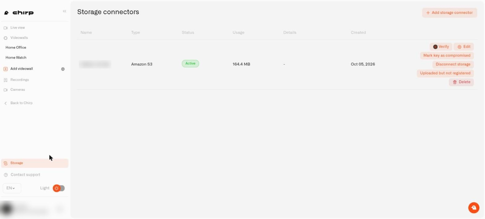
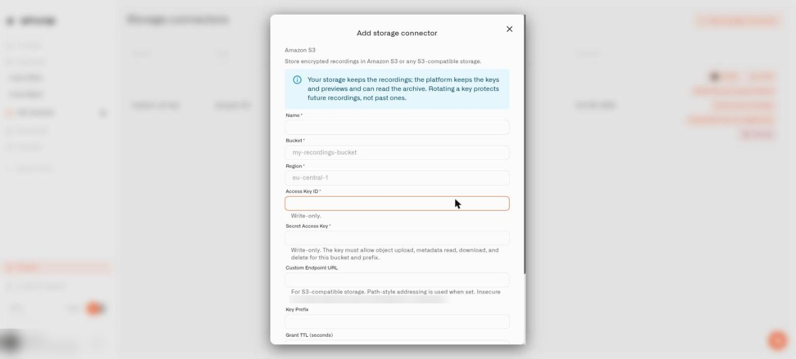
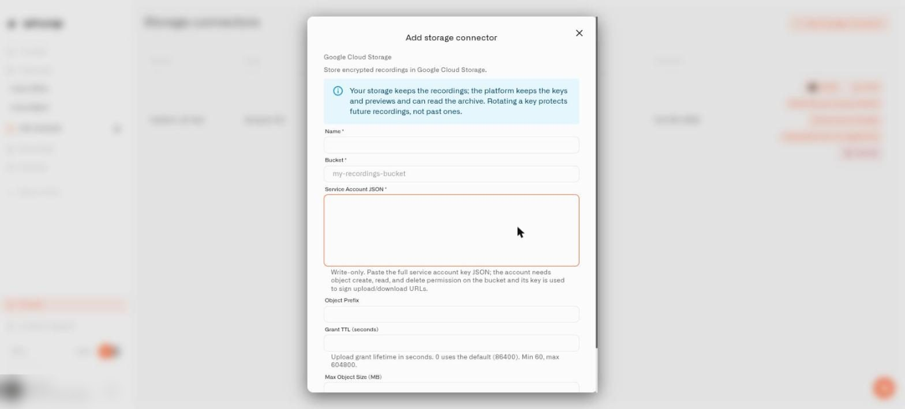
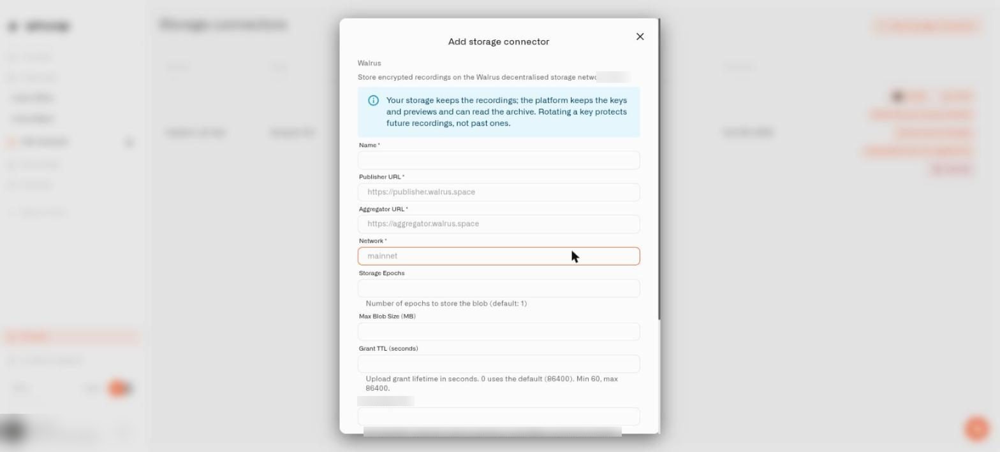

# Set Up a Lens Storage Connector

A **storage connector** is the saved connection between Chirp Lens and the cloud account that holds your backed-up clips. If you want the overview first, read [Back Up Home Camera Recordings to the Cloud](cloud-archive.md).

## Where do I add a connector?

1. Open **Cameras** from the main menu, which switches the sidebar to Lens.
2. Select **Storage** near the bottom of the sidebar. The page is titled **Storage connectors**; when empty it says there are no connectors yet and invites you to add the first.
3. Select **Add storage connector**. A small dialog asks for a **Connector type**: **Amazon S3**, **Google Cloud Storage**, or **Walrus**.
4. Choose one and select **Next**. Every form begins with a blue note that repeats the privacy rule, then a required **Name**, then the provider's fields. Required fields carry an asterisk, and **Add connector** stays disabled until they are complete.

## What is on the Storage connectors page?

<figure><figcaption>
The Storage connectors page with one connector.
</figcaption></figure>

The table has the columns **Name**, **Type**, **Status**, **Usage**, **Details**, and **Created**. A connector that works shows **Active** in **Status**, and **Usage** adds up what Chirp has stored there. A problem with uploads is explained in **Details**. **Add storage connector** sits at the top right. Each row ends with these buttons:

* **Verify** checks the connector again. Use it after you correct a setting or a credential.
* **Edit** opens the form again. Leave a secret blank to keep the stored one.
* **Mark key as compromised** issues a fresh key for new clips and sends it to your cameras. Clips recorded earlier stay readable.
* **Disconnect storage** erases Chirp's keys for this connector after you type its name. Cameras that still write to it must be moved first. [Back Up Home Camera Recordings to the Cloud](cloud-archive.md#how-do-i-stop-using-a-storage-account) has the details.
* **Uploaded but not registered** lists files that reached your storage during the last 30 days but whose upload never finished. Chirp does not track them, so remove them in your own storage.
* **Delete** removes the connector.

## What do I enter for Amazon S3 or a compatible service?

- **Bucket** and **Region**: the bucket name (placeholder `my-recordings-bucket`) and its region (placeholder `eu-central-1`).
- **Access Key ID** and **Secret Access Key**: the credentials Chirp uses. The secret field is write-only, and its hint says the key must allow upload, metadata read, download, and delete for the bucket and prefix.
- **Custom Endpoint URL**: only for S3-compatible services outside Amazon. Setting it switches to path-style addressing. The address must be secure and publicly reachable; private or insecure addresses are refused.
- **Key Prefix**: a folder-like prefix so Chirp's files stay apart from anything else in the bucket.
- **Grant TTL (seconds)**: the lifetime of each upload permission. Zero uses the default of 86400, and the accepted range is 60 to 604800.
- **Max Object Size (MB)**: an upper limit per clip.

Tip: create a dedicated access key for Chirp with only those four permissions on only that bucket.

<figure><figcaption>
The Amazon S3 form.
</figcaption></figure>

## What do I enter for Google Cloud Storage?

- **Bucket** and a large **Service Account JSON** box: paste the whole key file. It is write-only. The service account needs permission to create, read, and delete objects in the bucket, because Chirp uses it to sign upload and download links.
- **Object Prefix**, **Grant TTL (seconds)** (same rules as above, 60 to 604800), and **Max Object Size (MB)** are optional.

This storage type is new in this release. Test with one short clip and play it back before you rely on it.

<figure><figcaption>
The Google Cloud Storage form.
</figcaption></figure>

## What do I enter for Walrus?

- **Publisher URL** and **Aggregator URL** (both required): where Chirp sends clips and where it reads them back. Pick an aggregator that supports range requests so playback can skip ahead.
- **Network** (required), for example `mainnet`.
- **Storage Epochs**: how many storage periods to buy; the default is 1. Think of it as the minimum retention for each clip.
- **Max Blob Size (MB)** and **Grant TTL (seconds)** (for Walrus the maximum is 86400, minimum 60, zero means 86400).
- An optional endpoint field that tells Chirp which network node to ask for the current storage period; empty uses the network's default.
- For a private publisher, **Publisher JWT secret** (write-only) and **Publisher JWT algorithm** (HS256 by default, or HS384 / HS512).

<figure><figcaption>
The Walrus form.
</figcaption></figure>

## How are my secrets handled after I save?

Secret fields never display their value again. Editing a connector and leaving a secret blank keeps the stored one, but changing the endpoint requires you to enter the credentials again. Rotate them in your cloud console if someone who knew them should no longer have access. What a rotated key does and does not protect is explained in [the privacy section](cloud-archive.md#is-a-backed-up-clip-private).
