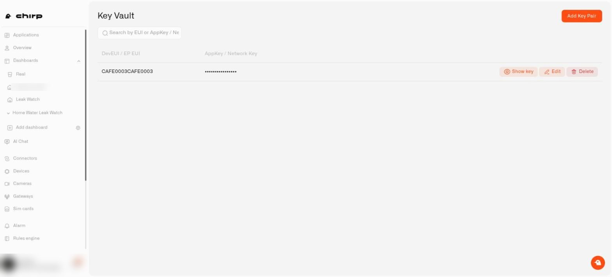
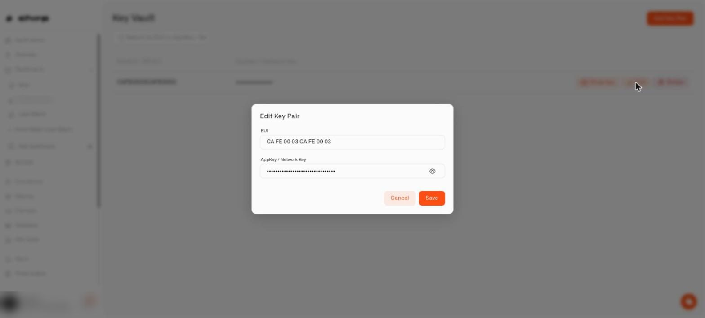

# What is Key Vault in Chirp?

Every LoRaWAN sensor you buy arrives with two codes: a **DevEUI** (its serial number on the radio network) and an **AppKey** (the secret that lets it join your home securely). They usually live on a tiny sticker on the back of the sensor, or on a slip of paper inside the box — and once that sensor is screwed to the garage wall or buried in a flowerbed, those codes are out of practical reach.

Key Vault is an encrypted place inside your Chirp home where those pairs live instead. You save the DevEUI and AppKey once, and they're there whenever you need them again — no torch, no ladder, no shoebox of manuals.

## Why would I store my sensor codes in Key Vault?

Sensor codes have a habit of being needed at exactly the wrong moment:

- **A factory reset, two years later.** Your soil moisture probe stops behaving, you reset it, and now it needs to rejoin — with the AppKey printed on a sticker that has been sun-bleached blank.
- **You're moving house.** Everything comes off the walls and goes in a box. Re-adding twenty sensors at the other end is only pleasant if you still have their codes.
- **Someone else needs to fix it while you're away.** Your partner can re-add the leak sensor without calling you to describe a sticker over the phone.
- **The manual drawer.** You know the one. Key Vault is the reason you can finally recycle it.

The codes are stored encrypted, and they belong to your home — not to your personal account — so the right household members can reach them and nobody else can.

Codes don't sit open on the screen either. Each one shows as a row of dots until you tap **Show key** beside it; tap **Hide key** and it's covered again. That makes it safe to open the list with a guest on the sofa or to share your screen with a support person. Every household member who can open Key Vault gets the **Show key** button, even if they can't change anything. While you type or paste a code into the add and edit windows, the characters stay visible so you can check them against the sticker, then hide again when you move on.

> **Key Vault is not the same thing as [API Keys](../settings/api-keys.md).** API keys let *other apps and scripts* talk to Chirp on your behalf; Key Vault stores the codes *your sensors themselves* use to join your network.

## Where do I find Key Vault?

In the sidebar, look under **Records & Reports** and pick **Key Vault**.

You'll see the key pairs saved for the home you're currently viewing. If nothing has been saved yet, Chirp asks the obvious question — *"Still keeping your Device keys on paper?"* — with an **Add your first key pair** button to get going.

## What is on the Key Vault screen?

Reading the page from top to bottom:

* **Add Key Pair** is the button at the top right.
* A **search box** above the list finds a pair by sensor code, so a long vault stays easy to scan.
* The list has two columns, **DevEUI / EP EUI** and **AppKey / Network Key**. The second column always displays a string of dots instead of the real code.
* At the end of each row sit three buttons: **Show key** (the eye icon), **Edit**, and **Delete**. **Show key** uncovers that one row's code, and the same button then reads **Hide key**. Reveal one row at a time and cover it again when you are done; the other rows stay masked. Members with view-only access can use **Show key** too, since they may need to read a code out loud.

<figure><figcaption>
The Key Vault list. The key stays hidden until you show it.
</figcaption></figure>

Inside the **Add Key Pair** and **Edit** dialogs the AppKey field also starts hidden. It shows what you type while you are typing, covers itself again when you click away or press Enter, and has its own eye button for a closer look at a stored value.

<figure><figcaption>
The Edit Key Pair dialog and its eye button.
</figcaption></figure>

## What do the EUI and AppKey fields mean?

The form calls its two fields **EUI** and **AppKey / Network Key**, while your sensor's own documentation is likely to use slightly different words for the same two values. Read them as:

- **EUI** → your sensor's **DevEUI**
- **AppKey / Network Key** → your sensor's **AppKey**

## How do I add a key pair?

1. On the Key Vault page, click **Add Key Pair**.
2. In **EUI**, type or paste your sensor's DevEUI. It's **16 hex characters** — the digits `0`–`9` and the letters `A`–`F`.
3. In **AppKey / Network Key**, type or paste the AppKey. This one is longer: **32 hex characters**.
4. Click **Save**.

You'll get a **"Key pair saved to vault"** confirmation and the pair appears in the list.

**Save** stays dimmed until the **EUI** has all 16 characters and the **AppKey / Network Key** has all 32, so there is no error message to read in this window: if the button will not light up, count the characters in each field.

The messages below appear when you press **Add to Vault** on a sensor form (see the next section) with a field that is empty or too short, and when a save does not go through:

| Message | What it means |
|---|---|
| *"EUI is incomplete."* | The EUI is short of 16 characters — check for a missing digit. |
| *"AppKey / Network Key is incomplete."* | The AppKey is short of 32 characters. |
| *"Enter both EUI and AppKey / Network Key before saving to the vault."* | One of the two fields is still empty. Both are needed. |
| *"Failed to save key pair"* | The save didn't go through. The most likely reasons are that this exact pair is already in the vault, or your home has reached the number of pairs it can store — see [the limit](#is-there-a-limit-on-key-pairs). |

The vault won't store the same EUI and key twice, so if you paste in a pair you've already saved, nothing is duplicated.

## How do I save a key pair while adding a sensor?

The easiest moment to save a code is the moment you're already holding it. When you're adding a LoRaWAN sensor and have just typed in its DevEUI and AppKey, use **Add to Vault** on the sensor form. The pair goes straight into Key Vault — including the AppKey — without you having to type it a second time.

Full walkthrough of the sensor form: [Adding Sensors](../devices/adding-sensors.md).

## How do I search for a key pair?

Above the list is a **Search by EUI or AppKey / Network Key** box. You don't need the whole code — a fragment is enough, so the last four characters you can still read on the sticker will usually find it.

- Type at least **2 characters**. Below that, Chirp prompts *"Enter at least 2 characters to search."* and, as you type the first character, *"Keep typing to search"*.
- If nothing matches, you'll see **"No key pairs found"** with the hint *"Try another EUI or AppKey / Network Key search."* Try a shorter fragment, or search on the other code — a mistyped character in one field won't stop the other from matching.

## How do I edit a key pair?

Codes get typed wrong, and sometimes a sensor is replaced under warranty and comes back with new ones.

1. Find the pair in the list.
2. Click **Edit** at the end of its row. The window that opens is titled **Edit Key Pair**.
3. Correct the **EUI**, the **AppKey / Network Key**, or both. The same 16- and 32-character rules apply.
4. Save. You'll see **"Key pair updated"**.

If the update can't be applied you'll see **"Failed to update key pair"** — check the pair isn't a duplicate of one already stored, then try again.

## How do I delete a key pair?

Retired a sensor? Clear it out so the vault stays a list of things you actually own.

1. Find the pair and click **Delete** at the end of its row.
2. A window titled **Are you sure?** asks: *"Are you sure you want to delete this key pair?"*
3. Click **Delete** in that window to confirm. You'll see **"Key pair deleted"**.

Deleting is permanent — once a pair leaves the vault, Chirp has no copy of it left. After that you are back to the sticker, the box it came in, or whatever your sensor's maker allows: a few models will hand the code back if you wire something to them, most won't, and neither is a job for a Saturday morning. If deletion fails you'll see **"Failed to delete key pair"**; refresh and try again.

Removing a pair from the vault does nothing to the sensor itself. A sensor already joined to your home carries on reporting exactly as before.

## Who can open Key Vault?

Key Vault is protected by its own **Key Vault** page permission, separate from the rest of Chirp. Someone can have full run of your dashboards and automations and still not be able to open the vault — which is usually what you want, since these codes are what let a device onto your network.

Give a household member Key Vault access the same way you give any other page access: see [Managing Access](../account/managing-access.md), and [Users & Permissions](../account/users-and-permissions.md) for how the permission levels work.

## Is there a limit on key pairs?

Chirp caps how many key pairs one home can store. The number is not shown on screen, so the first sign of reaching it is a save that fails with **Failed to save key pair**. Delete the entries for sensors you no longer own, then save again.

## What are good habits for storing sensor codes?

- **Save it when you unbox it.** The best time to add a pair is before the sensor goes on the wall, while the sticker is still in your hand and still readable.
- **Use Add to Vault on the sensor form.** It's one click during setup versus a retyped 32-character code later.
- **Photograph the sticker as a backup, but don't rely on the photo.** Phone libraries get cleared; the vault doesn't.
- **Copy and paste rather than type.** A 32-character AppKey is easy to get wrong by one character, and a wrong AppKey means the sensor silently refuses to join.
- **Prune when you retire a sensor.** It keeps searches clean and keeps you well inside your home's limit.
